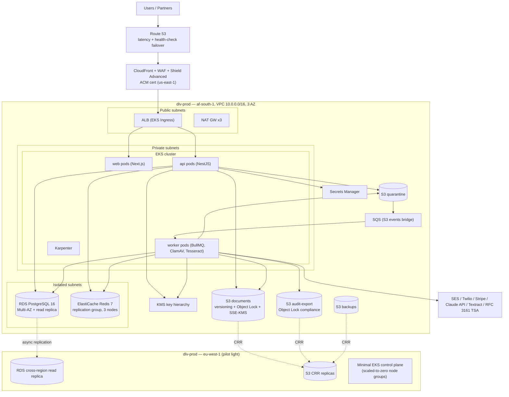

# AWS Architecture — Digital Legacy Vault

| Document Control | |
|---|---|
| Version | 1.0.0 |
| Date | 2026-07-05 |
| Status | Draft for Review |
| Owner | Architecture Team |
| Source of truth | `PROJECT_MEMORY.md` |

---

## 1. Region and account topology

- **Primary region:** `af-south-1` (Cape Town). **DR region:** `eu-west-1` (Ireland), pilot-light. Data residency: SA customer data primary in af-south-1; eu-west-1 copies exist for DR only.
- **AWS Organizations**, one account per environment plus shared services:

| Account | Purpose |
|---|---|
| `dlv-management` | Organizations root, SCPs, consolidated billing, IAM Identity Center |
| `dlv-security` | Delegated admin: GuardDuty, Security Hub, Inspector, CloudTrail org trail, audit-log archive |
| `dlv-shared` | ECR, Route 53 public zones, CI/CD artifacts, Argo CD bootstrap |
| `dlv-dev` | dev environment |
| `dlv-staging` | staging environment (prod-shaped, scaled down) |
| `dlv-prod` | production (af-south-1 + eu-west-1 DR resources) |

SCP guardrails: deny regions outside `af-south-1`/`eu-west-1`/`us-east-1` (us-east-1 only for CloudFront/WAF/ACM global resources), deny CloudTrail stop, deny KMS key deletion without MFA-backed break-glass role, deny public S3 ACLs (plus account-level Block Public Access).

Terraform owns all cloud resources (`infra/terraform/envs/{dev,staging,prod}` + reusable modules); state in S3 + DynamoDB locking per account. Helm + Argo CD (GitOps) own in-cluster resources.

## 2. Network — VPC layout (3 AZ)

Per environment, one VPC `10.<env>.0.0/16` (dev=10.10, staging=10.20, prod=10.0) across `af-south-1a/b/c`:

| Subnet tier | CIDR pattern | Contents | Egress |
|---|---|---|---|
| Public ×3 | `/22` per AZ | ALB (EKS ingress), NAT gateways (one per AZ in prod, one total in dev) | IGW |
| Private ×3 | `/20` per AZ | EKS node groups / pods, internal ALBs | NAT |
| Isolated ×3 | `/24` per AZ | RDS, ElastiCache | none (no route to NAT/IGW) |

- **VPC endpoints** (gateway: S3, DynamoDB; interface: ECR, KMS, Secrets Manager, CloudWatch Logs, STS, SQS, Textract, SES) keep service traffic off the NAT and inside the AWS backbone — also a material NAT cost saver.
- Security groups: ALB → nodes (pod ports only); nodes → RDS 5432; nodes → Redis 6379; deny-all default. Network ACLs on isolated subnets restrict to VPC CIDR.
- VPC flow logs → CloudWatch (dev 7 d) / S3 (prod 365 d).

## 3. Diagram



## 4. EKS cluster design

- One cluster per environment (`dlv-<env>`), Kubernetes version n-1 from latest EKS-supported, private API endpoint (public access CIDR-restricted to CI + VPN in non-prod, disabled in prod via VPN/SSM access).
- **Node groups:**

| Group | Instances | Purpose |
|---|---|---|
| `system` (managed, on-demand) | m6i.large ×3 (one per AZ) | CoreDNS, Karpenter, Argo CD, ingress controller, observability agents; tainted `CriticalAddonsOnly` |
| `apps` (Karpenter-provisioned) | m6i/m5 family, on-demand, consolidation on | web + api pods |
| `workers` (Karpenter-provisioned) | c6i family + Spot allowed | BullMQ workers, ClamAV, Tesseract; jobs are idempotent so Spot interruption is safe |

- **Karpenter** NodePools per workload class with limits (prod apps ≤ 64 vCPU, workers ≤ 96 vCPU), TTL-based consolidation, af-south-1 instance-type diversity (af-south-1 has a narrower instance catalogue — pools list ≥ 4 types).
- **IRSA** (IAM Roles for Service Accounts) for every workload; no node-level AWS permissions beyond ECR pull/CNI. Distinct roles: `api` (S3 documents/quarantine, KMS via key policy, SQS, Secrets Manager read), `workers` (adds Textract, SES send, audit-export write), `external-dns`, `aws-load-balancer-controller`, `external-secrets`.
- Add-ons: AWS Load Balancer Controller, ExternalDNS, External Secrets Operator (syncs from Secrets Manager), metrics-server, ADOT collector, Argo CD (app-of-apps from `infra/helm`).
- Pod security: restricted PodSecurity standard, read-only root FS, non-root, NetworkPolicies default-deny per namespace (`web`, `api`, `workers`, `platform`).

## 5. Data stores

### 5.1 RDS PostgreSQL 16
- `db.r6g.xlarge` Multi-AZ (prod), storage autoscaling gp3, encrypted with `dlv-prod-data` KMS key.
- **One read replica in af-south-1** (GraphQL dashboard/timeline + audit reads) and **one cross-region replica in eu-west-1** (DR, pilot light).
- Automated backups 35 days PITR; snapshots copied cross-region daily. RDS Proxy in front for connection pooling (Prisma + Lambda-free but many pods). Performance Insights + Enhanced Monitoring on. `rds.force_ssl=1`.

### 5.2 ElastiCache Redis 7
- Replication group: 1 primary + 2 replicas across 3 AZ, Multi-AZ auto-failover, cluster-mode disabled (BullMQ compatibility), TLS in transit + at-rest encryption + AUTH token from Secrets Manager.
- `noeviction` policy (queues must not be evicted); sizing alarm at 70% memory. Sessions/cache/queues share the group at launch; queues split to a second group when p99 latency or memory pressure dictates.

## 6. S3 bucket strategy

| Bucket | Purpose | Controls |
|---|---|---|
| `dlv-prod-quarantine-af1` | untrusted uploads pre-scan | SSE-KMS; lifecycle: delete after 7 d; event → SQS → virus-scan queue; no CRR |
| `dlv-prod-documents-af1` | promoted documents + versions + signature evidence | Versioning; **Object Lock compliance mode** on signed/legal objects (retention = legal-hold driven, default 7 y for signed docs); SSE-KMS per-tenant keys; CRR → `dlv-prod-documents-euw1`; lifecycle: non-current versions → Glacier Flexible Retrieval after 90 d, Deep Archive after 365 d |
| `dlv-prod-audit-export-af1` | hourly hash-chained audit exports | Object Lock **compliance mode**, 10-y retention; CRR → eu-west-1; lifecycle → Glacier after 180 d |
| `dlv-prod-backups-af1` | logical DB dumps, Velero, config exports | SSE-KMS; CRR → eu-west-1; lifecycle → Glacier after 30 d, expire 400 d |

All buckets: Block Public Access, bucket policies enforcing `aws:SecureTransport` and SSE-KMS header, access via IRSA roles only, S3 server access logs + CloudTrail data events (prod), inventory reports for reconciliation against `document_versions.sha256`.

## 7. Edge — CloudFront, WAF, Shield, Route 53

- **CloudFront:** two behaviours — static/ISR (origin: web ALB, long TTLs on hashed assets) and `/api/*` + `/graphql` (no caching, origin: API ALB, origin custom header secret so ALBs reject non-CloudFront traffic). TLS 1.3, HSTS preload, security headers via response-headers policy.
- **WAF (on CloudFront):** AWS managed rules (Core, Known Bad Inputs, SQLi, IP reputation, Bot Control on auth endpoints), custom rate rules mirroring API tiers for L7 flood, geo rules log-only (no geo blocking at launch).
- **Shield Advanced** on prod (DDoS response team + cost protection); Standard elsewhere.
- **Route 53:** public zone `dlv.stellr-net.com` (assumption; final domain is a product decision) — `app.`, `api.`, `docs.` records alias to CloudFront; health checks drive failover routing to the DR endpoint during regional failover. Private hosted zone for in-VPC service names.

## 8. KMS key hierarchy

```
dlv-prod-root (account/environment boundary — key policies, no data usage)
├── dlv-prod-data          # RDS, ElastiCache, EBS, backups
├── dlv-prod-s3-platform   # quarantine, audit-export, backups buckets
├── dlv-prod-tenant-cmk-*  # per-tenant CMKs (pooled: one per org / per 1k individual users)
│     └── wraps per-document DEKs (AES-256-GCM) — envelope encryption
├── dlv-prod-field         # field-level PII encryption (ID numbers, crypto recovery refs, emergency contacts)
└── dlv-prod-signing       # asymmetric: JWT RS256 signing, webhook secret derivation, audit chain anchoring
```

- Annual automatic rotation + on-demand rotation API for tenant CMKs (re-wraps DEKs, never re-encrypts objects).
- Multi-Region keys (replicas in eu-west-1) for `data`, `s3-platform`, and tenant CMKs so CRR replicas and DR restores decrypt without cross-region KMS calls.
- Key policies grant usage only to specific IRSA roles; grants are audited; deletion requires 30-day pending window + break-glass role.

## 9. Secrets Manager

- All application secrets (DB creds via managed rotation every 30 d, Redis AUTH, Stripe keys, Twilio, Claude API key, TSA credentials, webhook signing master secret) in Secrets Manager; **no secrets in code or env files** (security invariant 7).
- External Secrets Operator syncs into namespaced K8s Secrets; pods restart on rotation via reloader annotation. Naming: `dlv/<env>/<context>/<name>`.

## 10. Egress — SES and Twilio

- **SES** in af-south-1 (fallback eu-west-1 if a sending feature is unavailable): dedicated IP pool (prod), DKIM+SPF+DMARC (`p=reject`), configuration sets with event destinations → SNS → delivery/bounce/complaint tracking into `notification` context; suppression list honoured.
- **Twilio** (SMS + WhatsApp Business API): outbound HTTPS from worker pods via NAT; status callbacks land on `/api/v1/webhooks/twilio` (signature-verified). Sender IDs / WABA registered for SA.

## 11. Observability

- **Metrics/logs:** CloudWatch (Container Insights) + structured JSON logs (pino) shipped by Fluent Bit; log groups per app; prod retention 90 d hot, archived to S3 for 1 y.
- **Tracing:** OpenTelemetry SDK in web/api/workers → ADOT collector → X-Ray (trace) + CloudWatch (metrics); `traceparent` propagated edge-to-worker via BullMQ job metadata; `traceId` echoed in problem+json.
- **Dashboards/alarms:** golden signals per container, RDS (CPU, connections, replica lag), Redis (memory, evictions=0 expected), queue depth/age per BullMQ queue, DLQ non-empty, upload-pipeline p95, webhook failure rate, certificate expiry. Alarms → SNS → PagerDuty (assumption: PagerDuty as on-call tool).
- **Security telemetry:** GuardDuty (incl. EKS Protection, S3 Protection, Malware Protection), Security Hub (CIS + AWS Foundational Best Practices, delegated to `dlv-security`), Inspector (ECR image + EC2/EKS scanning), CloudTrail org trail (all accounts, S3 data events on documents/audit buckets), IAM Access Analyzer. Findings ≥ HIGH page on-call.

## 12. DR strategy — RPO 15 min / RTO 4 h (pilot light in eu-west-1)

**Standing DR resources (pilot light):** RDS cross-region read replica (async, typical lag < 1 min ≤ RPO 15 min), S3 CRR replicas (documents/audit/backups; replication SLA monitored via S3 RTC metrics), multi-Region KMS key replicas, Terraform-defined-but-scaled-down EKS (control plane active, node groups at 0), replicated ECR images, replicated Secrets Manager secrets, warm Route 53 failover records.

**Failover runbook (target ≤ 4 h, exercised quarterly in staging, annually in prod):**
1. Declare disaster (two-person rule) — T+0.
2. Promote eu-west-1 RDS replica to standalone primary — T+15 min.
3. Create ElastiCache replication group from Terraform (cache is rebuildable; queued jobs re-derived from outbox table, which lives in Postgres) — T+45 min.
4. Scale Karpenter/system node groups up; Argo CD syncs workloads pointed at DR endpoints (config via per-region values files) — T+90 min.
5. Flip Route 53 failover (health checks may have flipped read-only static page already); re-point CloudFront origins — T+2 h.
6. Validate: synthetic journeys (login, upload→quarantine→promote, audit write), reconcile outbox/queues, confirm webhook dispatch — T+3 h.
7. Communicate; begin fail-back planning (reverse replication once af-south-1 recovers).

**RPO notes:** Postgres async replication and S3 RTC both target < 15 min. The audit hash chain plus hourly Object Lock exports bound audit loss; document object loss is bounded by CRR lag with reconciliation from `document_versions` records.

## 13. Environment separation

| | dev | staging | prod |
|---|---|---|---|
| Account | dlv-dev | dlv-staging | dlv-prod |
| RDS | single-AZ db.t4g.medium | Multi-AZ db.r6g.large | Multi-AZ db.r6g.xlarge + 2 replicas |
| NAT | 1 gateway | 3 | 3 |
| Shield | Standard | Standard | Advanced |
| DR region | none | none (DR runbook tested here against synthetic data) | eu-west-1 pilot light |
| Data | synthetic only | synthetic + anonymised | customer data |

Promotion: trunk-based; GitHub Actions builds once → ECR in `dlv-shared`; Argo CD promotes image tags dev → staging → prod (prod sync requires manual approval gate).

## 14. Cost awareness

- af-south-1 carries a regional price premium (~15–25% over eu-west-1 for common services) — accepted for data residency; DR in eu-west-1 is the cheaper region, which suits pilot light.
- Biggest levers: Karpenter consolidation + Spot for workers (idempotent jobs), VPC endpoints to cut NAT processing (S3-heavy upload pipeline), Glacier lifecycle on non-current document versions, single NAT in dev, RDS/ElastiCache reserved instances after 3 months of baseline data, CloudFront caching offloading the web tier.
- Guardrails: AWS Budgets per account with 80/100% alerts, Cost Anomaly Detection, mandatory cost-allocation tags (`env`, `context`, `service`) enforced by Terraform validation and an SCP-checked tag policy.
- Order-of-magnitude prod baseline estimate (pre-scale, af-south-1): EKS nodes ~$1.2k/mo, RDS ~$1.5k/mo, ElastiCache ~$450/mo, NAT+endpoints ~$300/mo, S3+CloudFront ~$200/mo, Shield Advanced $3k/mo (deferred until enterprise contracts justify it — Standard until then; this is the single largest discretionary line item).
