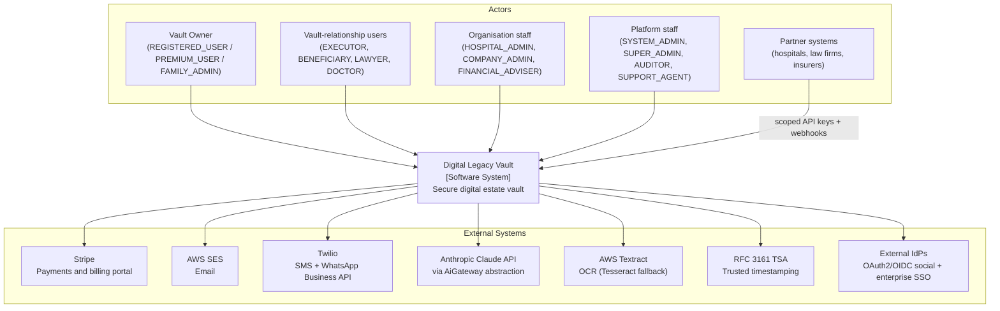
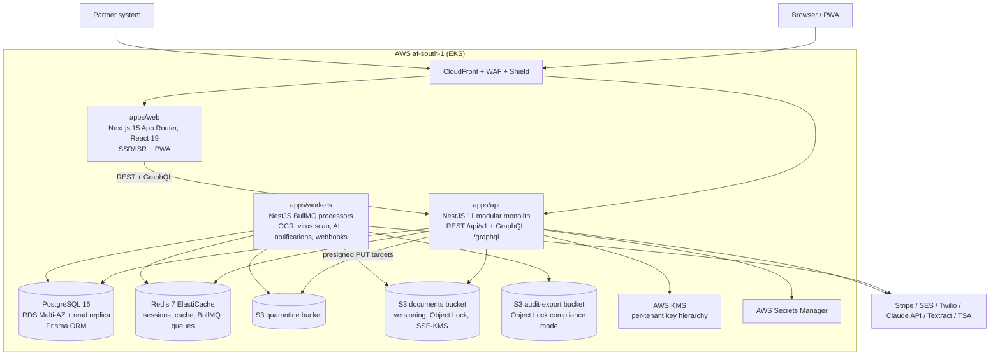
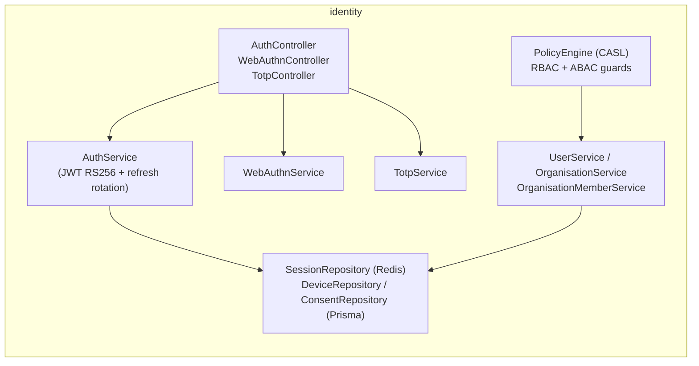
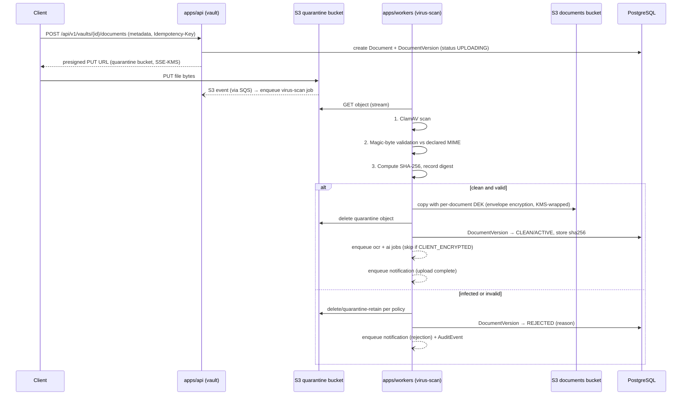

# System Architecture — Digital Legacy Vault

| Document Control | |
|---|---|
| Version | 1.0.0 |
| Date | 2026-07-05 |
| Status | Draft for Review |
| Owner | Architecture Team |
| Source of truth | `PROJECT_MEMORY.md` |

---

## 1. Overview

Digital Legacy Vault (DLV) is a secure digital estate vault delivered as a freemium SaaS with organisation (B2B) plans. The system is built as a **modular monolith** (NestJS 11) fronted by a Next.js 15 web application, backed by PostgreSQL 16 (Prisma), Redis 7 (BullMQ), and S3, deployed on AWS EKS in `af-south-1` with DR in `eu-west-1`.

Architecture goals, in priority order:

1. **Security and evidentiary integrity** — tiered encryption, append-only hash-chained audit, quarantine pipeline, deny-by-default authorization.
2. **Regulatory posture** — POPIA-first, GDPR-ready, ISO 27001 alignment, SOC 2 Type II target, HIPAA-ready design.
3. **Evolvability** — DDD bounded contexts inside one deployable, with a defined extraction path to services.
4. **Operability** — one API deployable + one worker deployable + one web deployable, GitOps via Argo CD.

---

## 2. C4 Level 1 — System Context

---

## 3. C4 Level 2 — Container Diagram

Container responsibilities:

| Container | Responsibility | Scaling unit |
|---|---|---|
| `apps/web` | Rendering, session bootstrap, client-side crypto for Client-Encrypted Vault, PWA/web push | HPA on CPU/RPS |
| `apps/api` | All synchronous business logic, authN/authZ, REST + GraphQL, job enqueue | HPA on CPU/latency |
| `apps/workers` | All asynchronous work (BullMQ consumers) | KEDA-style scaling on queue depth (via Karpenter-provisioned nodes) |

---

## 4. ADR-001 — Modular monolith first

**Status:** Accepted. **Date:** 2026-07-05.

**Context.** DLV has 11 bounded contexts, a small founding team, strict security invariants that span contexts (audit hash-chain, deny-by-default policy, envelope encryption), and no proven scale hotspots yet. Microservices from day one would multiply deployment surface, secrets, network policies, and audit complexity.

**Decision.** One NestJS 11 application (`apps/api`) containing all bounded contexts as isolated Nest modules, plus one worker deployable (`apps/workers`) consuming BullMQ queues. Each context follows clean-architecture layering (`domain/application/infrastructure/presentation`) and communicates with other contexts only via:

1. **Application-service interfaces** (injected via Nest DI tokens, never deep imports), and
2. **Domain events** on an in-process event bus (`@nestjs/event-emitter`) with a transactional outbox table for events that must reach workers/webhooks reliably.

Cross-context database access is forbidden: each context owns its tables; reads across contexts go through the owning context's application service or a read model.

**Consequences.**
- Single deployment, single Prisma schema, simple transactions where a use case is context-local.
- Module boundaries are enforced by ESLint boundary rules (see `folder-structure.md`), so the code stays extraction-ready.

**Extraction path.** When a context needs independent scaling or team ownership (expected first candidates: `ai`, `notification`, `signature`):
1. Its in-process interface is already the seam — replace the DI binding with an HTTP/queue client implementing the same interface.
2. Outbox events move from in-process dispatch to SNS/SQS (or Kafka if volumes warrant).
3. Its tables move to a dedicated schema, then a dedicated database, with the read models it exposed becoming APIs.
4. The worker processors for that context move with it (they are already grouped per context in `apps/workers`).

**Rejected alternatives.** Microservices-first (operational cost, distributed transactions across audit/vault); serverless-first (cold starts on crypto-heavy paths, EKS already required for ClamAV/Tesseract workers).

---

## 5. C4 Level 3 — Component view per bounded context

All 11 contexts live in `apps/api/src/modules/<context>`. Below, each context's key components; every context also exposes a `presentation` layer (REST controllers, GraphQL resolvers where applicable) and emits `AuditEvent`s via the `audit` context's application service.

### 5.1 `identity` — users, orgs, auth, roles

Entities owned: `User`, `Organisation`, `OrganisationMember`, `Device`, `Session`, `Consent`. The `PolicyEngine` is exported to every other context — it is the single authorization seam (deny-by-default; every endpoint declares a policy).

### 5.2 `vault` — documents, versions, metadata, OCR

Components: `VaultService`, `DocumentService`, `DocumentVersionService`, `UploadService` (presigned quarantine URLs, magic-byte validation contract), `EncryptionService` (per-document DEK, KMS wrap/unwrap via per-tenant CMK), `OcrIngestService` (consumes OCR results, never for Client-Encrypted documents), `SearchIndexService` (Postgres `tsvector`). Entities: `Vault`, `Document`, `DocumentVersion`, `DocumentCategory`, `Tag`, `LegalHold`.

### 5.3 `sharing` — shares, secure links, QR, access requests

Components: `DocumentShareService`, `SecureLinkService` (token hashing, TTL, max-view counts, QR payload generation), `AccessRequestService`. Entities: `DocumentShare`, `SecureLink`.

### 5.4 `estate` — beneficiaries, executors, emergency access, death verification

Components: `BeneficiaryService`, `ExecutorService`, `EmergencyAccessService` (multi-party approval + mandatory time delay + owner notification — security invariant 6), `DeathVerificationWorkflow` (state machine: `REPORTED → EVIDENCE_SUBMITTED → VERIFIER_REVIEW → APPROVED/REJECTED`, verifiers are DOCTOR/HOSPITAL_ADMIN or SUPPORT_AGENT-mediated documentary proof). Entities: `Beneficiary`, `Executor`, `EmergencyAccessRequest`, `EmergencyAccessGrant`.

### 5.5 `signature` — signing ceremonies, seals, evidence

Components: `SignatureRequestService`, `CeremonyService` (draw/type/upload capture), `SealService` (SHA-256 digest + RFC 3161 timestamp + signer identity + device evidence bundle), `EvidencePackager` (writes evidence bundle to the documents bucket under Object Lock). Entities: `SignatureRequest`, `Signature`.

### 5.6 `notification` — email/SMS/WhatsApp/push, reminders

Components: `NotificationService` (channel routing + user preferences), `ReminderScheduler` (BullMQ repeatable jobs), channel adapters `SesAdapter`, `TwilioAdapter`, `WebPushAdapter`. Entities: `Notification`, `Reminder`. Delivery itself happens in `apps/workers`.

### 5.7 `billing` — plans, subscriptions, Stripe

Components: `PlanService`, `SubscriptionService`, `StripeWebhookHandler` (signature-verified, idempotent), `EntitlementService` (feature gates consumed by `PolicyEngine`). Entities: `Plan`, `Subscription`. Money is integer minor units + currency code (ZAR primary).

### 5.8 `audit` — immutable audit events, activity timeline

Components: `AuditWriter` (append-only insert with `prev_event_hash` chaining — SHA-256 of previous event per vault chain), `AuditQueryService` (timeline reads, GraphQL), `AuditExportJob` (periodic export to S3 audit-export bucket with Object Lock compliance mode). Entity: `AuditEvent`.

### 5.9 `ai` — classification, summaries, recommendations, NL search

Components: `AiGateway` (provider abstraction over Anthropic Claude API), `ClassificationService`, `SummaryService`, `RecommendationService`, `NlSearchService`. Hard rule enforced at the gateway: **Client-Encrypted Vault content is never sent to AI or OCR** (checked against `Document.encryptionTier` before enqueue and again in the worker).

### 5.10 `admin` — back-office

Components: `AdminUserService`, `SupportCaseTools`, `PlatformMetricsService`. All actions require platform roles and produce audit events; SUPPORT_AGENT access to customer data is break-glass, time-boxed, and owner-notified.

### 5.11 `integration` — API keys, webhooks, partner APIs

Components: `ApiKeyService` (hashed keys, org-scoped, scope strings), `WebhookService` (subscription management, HMAC signing), `WebhookDispatcher` (worker-side, retry/backoff), `PartnerApiFacade` (hospital/law-firm/insurer endpoints incl. emergency-access API). Entities: `ApiKey`, `Webhook`.

---

## 6. Request lifecycle (synchronous path)

1. **Edge:** Client → Route 53 → CloudFront → WAF (managed + custom rules) → ALB (Ingress) → `apps/api` pod. TLS 1.3 only, end to end.
2. **Middleware chain (Nest):** request-ID + traceparent propagation → body limits → `helmet` headers.
3. **AuthN guard:** JWT access token verified (RS256 via JWKS); for cookie sessions the Redis `Session` record is checked (revocation-aware). API-key auth path for partner requests (hash lookup + scope load).
4. **Rate-limit guard:** Redis token bucket keyed by user/org/API key tier.
5. **AuthZ guard:** `PolicyEngine` (CASL) evaluates RBAC role + ABAC attributes (org membership, vault relationship, entitlements, document tier). Deny-by-default: a route without a declared policy fails closed at startup.
6. **Idempotency interceptor (mutating routes):** `Idempotency-Key` header checked/recorded in Redis with response replay.
7. **Controller → application service → domain:** validation via `zod` DTO pipes; use case executes inside a Prisma transaction where needed; domain events are written to the outbox in the same transaction.
8. **Audit + response:** `AuditWriter` records the event (same transaction for state-changing operations); outbox relay enqueues BullMQ jobs; RFC 9457 problem+json on error.

## 7. Asynchronous pipelines (BullMQ)

Queues (Redis 7): `ocr`, `virus-scan`, `ai`, `notifications`, `webhooks`, `audit-export`, `reminders`, `billing-sync`. All jobs are idempotent (job ID = deterministic business key) with exponential backoff and dead-letter queues (`<queue>:dlq`).

### 7.1 Upload quarantine pipeline (security invariant 5)

Steps in words: (1) API issues a presigned PUT scoped to the quarantine bucket only; the client never touches the documents bucket. (2) S3 `ObjectCreated` events flow through SQS into the `virus-scan` queue. (3) Worker streams the object through ClamAV, validates magic bytes against the declared content type, computes and records SHA-256. (4) On success the object is re-encrypted under a freshly generated per-document DEK wrapped by the tenant CMK and promoted to the documents bucket (versioned; Object Lock applied for signed/legal document types); on failure it is rejected and the owner is notified. (5) Downstream `ocr` and `ai` jobs are enqueued only for Standard-tier documents.

### 7.2 Other pipelines

| Pipeline | Trigger | Worker behaviour |
|---|---|---|
| OCR | promotion of Standard-tier document | Textract (af-south-1 fallback: self-hosted Tesseract worker); text stored encrypted, indexed to `tsvector` |
| AI | OCR completion / user request | `AiGateway` → Claude API; classification (document type enum), summary, recommendations |
| Notifications | domain events via outbox | channel fan-out: SES, Twilio (SMS/WhatsApp), web push; per-channel retry |
| Webhooks | outbox events matching org subscriptions | HMAC-SHA256 signed POST, retry with exponential backoff + jitter (see `api-architecture.md`) |
| Audit export | hourly schedule | batch AuditEvents → JSONL → S3 audit-export (Object Lock compliance mode) |
| Reminders | BullMQ repeatable jobs | document expiry, review nudges, subscription renewals |

## 8. Caching strategy

| Layer | What | TTL / invalidation |
|---|---|---|
| CloudFront | static assets, Next.js ISR pages | asset-hash immutable; ISR revalidation |
| Redis — session | `Session` records, refresh-token family state | sliding TTL; revoked on logout/rotation-reuse detection |
| Redis — authZ | compiled CASL ability per (user, org) | 60 s TTL + explicit bust on role/membership/entitlement change |
| Redis — entitlements | plan features per org/user | bust on Stripe webhook |
| Redis — read cache | dashboard aggregates, category trees, plan catalogue | 5 min TTL, cache-aside |
| Redis — infrastructure | rate-limit buckets, idempotency records (24 h), BullMQ | per-mechanism |
| Postgres read replica | GraphQL dashboard/timeline reads, audit queries | replica-lag tolerant reads only |

**Never cached:** document content, DEKs/plaintext keys, emergency-access state, anything Client-Encrypted.

## 9. Multi-tenancy model

- **Row-level org/owner scoping.** Every tenant-owned table carries `organisation_id` (nullable for individual customers) and/or `vault_id`/`owner_user_id`. A Prisma client extension injects tenant predicates from the request context (AsyncLocalStorage) into every query — forgetting a `where` cannot leak cross-tenant rows. Postgres RLS policies on the most sensitive tables (`documents`, `audit_events`, `emergency_access_*`) provide defence in depth using `SET LOCAL app.current_org_id / app.current_user_id`.
- **ABAC on top.** Row scoping answers "which tenant"; CASL policies answer "is this actor, with this role and this vault relationship, allowed this action on this resource in its current state" (e.g. BENEFICIARY may read a document only through an active `EmergencyAccessGrant` or explicit `DocumentShare`).
- **Key isolation.** Per-tenant KMS key hierarchy: tenant CMK → per-document DEKs. A cross-tenant read bug still cannot decrypt another tenant's content.
- **Residency.** SA customer data primary in af-south-1; CRR to eu-west-1 exists for DR only and is covered by the same KMS controls.

## 10. Key ADRs

| ADR | Decision | Status |
|---|---|---|
| ADR-001 | Modular monolith (NestJS 11) with clean-architecture contexts; extraction path defined | Accepted |
| ADR-002 | BullMQ on Redis for async (OCR, virus scan, AI, notifications, webhooks); SQS bridge for S3 events | Accepted |
| ADR-003 | Tiered encryption: Standard (envelope, server-processable) default; optional Client-Encrypted Vault per document (client-side AES-256-GCM, Shamir recovery, no AI/OCR) | Accepted (PROJECT_MEMORY §2.4) |
| ADR-004 | REST `/api/v1` primary contract; GraphQL for read-heavy dashboard/timeline only | Accepted (PROJECT_MEMORY §2.7) |
| ADR-005 | Prisma ORM + tenant-scoping client extension + Postgres RLS defence in depth | Accepted |
| ADR-006 | Transactional outbox + in-process event bus for domain events; relay to BullMQ | Accepted |
| ADR-007 | Audit chain: append-only Postgres partitioned table, SHA-256 hash-chained, hourly Object Lock export | Accepted |
| ADR-008 | af-south-1 primary, eu-west-1 pilot-light DR (RPO 15 min / RTO 4 h) | Accepted |
| ADR-009 | Built-in signature ceremony (no DocuSign at launch); RFC 3161 seals | Accepted (PROJECT_MEMORY §2.9) |
| ADR-010 | AiGateway provider abstraction over Anthropic Claude API | Accepted (PROJECT_MEMORY §2.8) |
