# Database Design & ERD — Digital Legacy Vault

| Document Control | |
|---|---|
| Version | 1.0.0 |
| Date | 2026-07-05 |
| Status | Draft for Review |
| Owner | Architecture Team |
| Source of truth | `PROJECT_MEMORY.md` |

---

## 1. Conventions

PostgreSQL 16 (RDS Multi-AZ), Prisma ORM. Tables snake_case plural; PKs are **UUIDv7** (`uuid` column, app-generated for time-ordered index locality); all timestamps `timestamptz` UTC; money as integer minor units + `currency` char(3). Every tenant-owned table carries scoping columns (`vault_id`, `owner_user_id`, and/or `organisation_id`) for row-level scoping + RLS. Columns marked **[ENC]** are field-level encrypted (AES-256-GCM via `dlv-<env>-field` KMS-derived keys; ciphertext stored as `bytea`, searchable variants get a keyed-HMAC `_hash` sibling column). Supporting tables beyond the canonical entity list (`document_tags`, `emergency_access_approvals`, `webhook_deliveries`, `outbox_events`) are stated assumptions.

## 2. Entity-relationship diagram

```mermaid
erDiagram
    users ||--o{ organisation_members : "belongs to orgs via"
    organisations ||--o{ organisation_members : has
    users ||--o{ vaults : owns
    organisations ||--o{ vaults : sponsors
    users ||--o{ devices : registers
    users ||--o{ sessions : holds
    devices ||--o{ sessions : "used by"
    users ||--o{ consents : gives
    users ||--o{ notifications : receives

    vaults ||--o{ documents : contains
    document_categories ||--o{ documents : classifies
    document_categories ||--o{ document_categories : "parent of"
    documents ||--o{ document_versions : "versioned as"
    vaults ||--o{ tags : defines
    documents ||--o{ document_tags : tagged
    tags ||--o{ document_tags : applied
    documents ||--o{ document_shares : "shared via"
    users ||--o{ document_shares : "grantee of"
    organisations ||--o{ document_shares : "grantee of"
    documents ||--o{ secure_links : "exposed via"
    documents ||--o{ legal_holds : "frozen by"
    vaults ||--o{ legal_holds : "frozen by"

    vaults ||--o{ beneficiaries : names
    vaults ||--o{ executors : appoints
    users ||--o| beneficiaries : "may be"
    users ||--o| executors : "may be"
    vaults ||--o{ emergency_access_requests : "requested against"
    users ||--o{ emergency_access_requests : raises
    emergency_access_requests ||--o{ emergency_access_approvals : "approved by"
    emergency_access_requests ||--o| emergency_access_grants : "results in"
    users ||--o{ emergency_access_grants : "granted to"

    documents ||--o{ signature_requests : "signing of"
    document_versions ||--o{ signature_requests : "pins version"
    signature_requests ||--o{ signatures : collects
    users ||--o{ signatures : signs

    vaults ||--o{ audit_events : records
    vaults ||--o{ reminders : schedules
    documents ||--o{ reminders : "may target"

    plans ||--o{ subscriptions : "priced by"
    users ||--o{ subscriptions : "subscribes (B2C)"
    organisations ||--o{ subscriptions : "subscribes (B2B)"

    organisations ||--o{ api_keys : issues
    organisations ||--o{ webhooks : registers
    webhooks ||--o{ webhook_deliveries : attempts

    users {
        uuid id PK
        text email UK
        text password_hash
        text status
        bytea id_number_enc "ENC"
        bytea phone_enc "ENC"
        bytea totp_secret_enc "ENC"
        timestamptz deleted_at
    }
    organisations {
        uuid id PK
        text name
        text org_type
        text verification_status
        timestamptz deleted_at
    }
    organisation_members {
        uuid id PK
        uuid organisation_id FK
        uuid user_id FK
        text role
        text status
    }
    vaults {
        uuid id PK
        uuid owner_user_id FK
        uuid organisation_id FK
        text name
        text status
        int emergency_quorum
        timestamptz deleted_at
    }
    documents {
        uuid id PK
        uuid vault_id FK
        uuid category_id FK
        text document_type
        text title
        text encryption_tier
        text status
        timestamptz deleted_at
    }
    document_versions {
        uuid id PK
        uuid document_id FK
        int version_number
        text s3_key
        text sha256
        bigint size_bytes
        text mime_type
        bytea wrapped_dek
        text scan_status
    }
    document_categories {
        uuid id PK
        uuid parent_id FK
        text name
        boolean is_system
    }
    tags {
        uuid id PK
        uuid vault_id FK
        text name
    }
    document_tags {
        uuid document_id FK
        uuid tag_id FK
    }
    document_shares {
        uuid id PK
        uuid document_id FK
        uuid grantee_user_id FK
        uuid grantee_organisation_id FK
        text permission
        timestamptz expires_at
        timestamptz revoked_at
    }
    secure_links {
        uuid id PK
        uuid document_id FK
        text token_hash UK
        text pin_hash
        int max_views
        int view_count
        timestamptz expires_at
        timestamptz revoked_at
    }
    beneficiaries {
        uuid id PK
        uuid vault_id FK
        uuid user_id FK
        text full_name
        text relationship
        bytea contact_enc "ENC"
        text status
    }
    executors {
        uuid id PK
        uuid vault_id FK
        uuid user_id FK
        text status
        boolean is_primary
        timestamptz accepted_at
    }
    emergency_access_requests {
        uuid id PK
        uuid vault_id FK
        uuid requester_user_id FK
        uuid requester_api_key_id FK
        text reason_code
        jsonb evidence
        text status
        timestamptz delay_expires_at
    }
    emergency_access_approvals {
        uuid id PK
        uuid request_id FK
        uuid approver_user_id FK
        text decision
        timestamptz decided_at
    }
    emergency_access_grants {
        uuid id PK
        uuid request_id FK
        uuid vault_id FK
        uuid grantee_user_id FK
        jsonb scope
        timestamptz activated_at
        timestamptz expires_at
        timestamptz revoked_at
    }
    signature_requests {
        uuid id PK
        uuid document_id FK
        uuid document_version_id FK
        uuid requester_user_id FK
        text status
        timestamptz due_at
    }
    signatures {
        uuid id PK
        uuid signature_request_id FK
        uuid signer_user_id FK
        text method
        text digest_sha256
        bytea tsa_token
        text evidence_s3_key
        timestamptz signed_at
    }
    audit_events {
        uuid id PK
        uuid vault_id FK
        uuid actor_user_id
        text event_type
        text resource_type
        uuid resource_id
        text prev_event_hash
        text event_hash
        jsonb context
        timestamptz occurred_at PK "partition key"
    }
    notifications {
        uuid id PK
        uuid user_id FK
        text channel
        text template_key
        jsonb payload
        text status
        timestamptz read_at
    }
    reminders {
        uuid id PK
        uuid vault_id FK
        uuid document_id FK
        uuid created_by_user_id FK
        text schedule_cron
        timestamptz next_run_at
        text status
    }
    plans {
        uuid id PK
        text code UK
        text name
        int price_minor
        text currency
        text billing_interval
        jsonb features
    }
    subscriptions {
        uuid id PK
        uuid plan_id FK
        uuid user_id FK
        uuid organisation_id FK
        text stripe_subscription_id UK
        text status
        timestamptz current_period_end
    }
    api_keys {
        uuid id PK
        uuid organisation_id FK
        text key_hash UK
        text prefix
        jsonb scopes
        timestamptz expires_at
        timestamptz revoked_at
    }
    webhooks {
        uuid id PK
        uuid organisation_id FK
        text url
        bytea secret_enc "ENC"
        jsonb event_types
        text status
    }
    webhook_deliveries {
        uuid id PK
        uuid webhook_id FK
        uuid event_id
        text event_type
        int attempt
        int response_status
        timestamptz next_retry_at
    }
    devices {
        uuid id PK
        uuid user_id FK
        text device_kind
        text credential_id UK
        bytea public_key
        bigint sign_counter
        text aaguid
        timestamptz revoked_at
    }
    sessions {
        uuid id PK
        uuid user_id FK
        uuid device_id FK
        text refresh_family_id
        text refresh_token_hash UK
        inet ip
        timestamptz expires_at
        timestamptz revoked_at
    }
    consents {
        uuid id PK
        uuid user_id FK
        text consent_type
        text policy_version
        timestamptz granted_at
        timestamptz revoked_at
    }
    legal_holds {
        uuid id PK
        uuid document_id FK
        uuid vault_id FK
        uuid placed_by_user_id FK
        text reference
        text reason
        timestamptz released_at
    }
```

## 3. Table dictionary

Common columns on every table unless noted: `id uuid PK` (UUIDv7), `created_at timestamptz NOT NULL DEFAULT now()`, `updated_at timestamptz NOT NULL` (Prisma `@updatedAt`). Soft-deletable tables add `deleted_at timestamptz NULL` (see §6). **[ENC]** = field-level encrypted.

### identity context

**users** — soft-deletable
| Column | Type | Constraints / notes |
|---|---|---|
| email | citext | UNIQUE (partial: `WHERE deleted_at IS NULL`), NOT NULL |
| email_verified_at | timestamptz | NULL until verified |
| password_hash | text | argon2id; NULL for passkey/SSO-only accounts |
| first_name / last_name | text | NOT NULL |
| id_number_enc | bytea | **[ENC]** SA ID/passport number; sibling `id_number_hash text` (keyed HMAC) UNIQUE for duplicate detection |
| phone_enc | bytea | **[ENC]**; sibling `phone_hash` for lookup |
| totp_secret_enc | bytea | **[ENC]**; NULL if not enrolled |
| totp_recovery_codes | jsonb | argon2id hashes, single-use |
| platform_role | text | enum PLATFORM_ROLE; default REGISTERED_USER |
| status | text | enum USER_STATUS (ACTIVE, SUSPENDED, PENDING_VERIFICATION, DECEASED_VERIFIED, DELETED) |
| locale / timezone | text | defaults `en-ZA`, `Africa/Johannesburg` |

Indexes: `email`, `id_number_hash`, `status`.

**organisations** — soft-deletable
| Column | Type | Constraints |
|---|---|---|
| name | text | NOT NULL |
| org_type | text | enum ORG_TYPE (LAW_FIRM, HOSPITAL, INSURER, FINANCIAL_ADVISORY, COMPANY, FAMILY) |
| registration_number_enc | bytea | **[ENC]** company/practice registration |
| verification_status | text | enum (PENDING, VERIFIED, REJECTED) |
| billing_email | citext | NOT NULL |

**organisation_members**
| Column | Type | Constraints |
|---|---|---|
| organisation_id / user_id | uuid | FK; UNIQUE(organisation_id, user_id) |
| role | text | enum ORG_ROLE (COMPANY_ADMIN, HOSPITAL_ADMIN, LAWYER, DOCTOR, FINANCIAL_ADVISER, MEMBER) |
| status | text | INVITED, ACTIVE, SUSPENDED, REMOVED |
| invited_by_user_id | uuid | FK users, NULL |

Indexes: `(user_id)`, `(organisation_id, role)`.

**devices**
| Column | Type | Constraints |
|---|---|---|
| user_id | uuid | FK, NOT NULL |
| device_kind | text | enum (WEBAUTHN_PASSKEY, BROWSER, MOBILE_PWA) |
| credential_id | text | UNIQUE, NULL unless passkey |
| public_key | bytea | COSE key, passkeys only |
| sign_counter | bigint | passkey counter-regression check |
| aaguid / transports | text / jsonb | passkey metadata |
| display_name | text | user-editable |
| last_used_at / revoked_at | timestamptz | |

**sessions**
| Column | Type | Constraints |
|---|---|---|
| user_id / device_id | uuid | FK; device NULL |
| refresh_family_id | text | rotation family; reuse detection revokes whole family |
| refresh_token_hash | text | UNIQUE (SHA-256 of opaque token) |
| ip | inet | |
| user_agent | text | |
| amr | jsonb | auth methods (pwd, webauthn, totp, oidc) |
| expires_at / revoked_at | timestamptz | |

Indexes: `(user_id, revoked_at)`, `refresh_family_id`. Hot copy lives in Redis; Postgres row is the durable record.

**consents** — append-only in practice (revocation = `revoked_at`, never delete)
| Column | Type | Constraints |
|---|---|---|
| user_id | uuid | FK |
| consent_type | text | enum (TERMS, PRIVACY_POPIA, MARKETING, AI_PROCESSING, DATA_SHARING_PARTNER) |
| policy_version | text | e.g. `privacy-2026-07` |
| granted_at / revoked_at | timestamptz | granted NOT NULL |
| ip / user_agent | inet / text | evidence |

UNIQUE(user_id, consent_type, policy_version).

### vault context

**vaults** — soft-deletable
| Column | Type | Constraints |
|---|---|---|
| owner_user_id | uuid | FK users, NOT NULL |
| organisation_id | uuid | FK, NULL (org-sponsored vaults) |
| name | text | NOT NULL |
| status | text | enum VAULT_STATUS (ACTIVE, LOCKED, ESTATE_MODE, ARCHIVED) — ESTATE_MODE entered after verified death |
| emergency_quorum | int | NOT NULL DEFAULT 2, CHECK ≥ 1 |
| emergency_delay_hours | int | NOT NULL DEFAULT 48 |
| tenant_cmk_arn | text | per-tenant KMS CMK reference |

Index: `(owner_user_id)`, `(organisation_id)`. RLS enabled.

**documents** — soft-deletable
| Column | Type | Constraints |
|---|---|---|
| vault_id | uuid | FK, NOT NULL |
| category_id | uuid | FK document_categories, NULL |
| document_type | text | enum DOCUMENT_TYPE (§5) |
| title | text | NOT NULL |
| description | text | |
| encryption_tier | text | enum ENCRYPTION_TIER (STANDARD, CLIENT_ENCRYPTED) |
| status | text | enum DOCUMENT_STATUS (UPLOADING, PROCESSING, ACTIVE, REJECTED, ARCHIVED) |
| current_version_id | uuid | FK document_versions, NULL, deferred |
| expiry_date | date | NULL; drives reminders |
| ocr_text_tsv | tsvector | GIN index; NULL for CLIENT_ENCRYPTED |
| ai_summary_enc | bytea | **[ENC]**; never populated for CLIENT_ENCRYPTED |

Indexes: `(vault_id, status)`, `(vault_id, document_type)`, `(vault_id, category_id)`, GIN `ocr_text_tsv`, `(expiry_date) WHERE expiry_date IS NOT NULL`. RLS enabled.

**document_versions** — immutable rows (no updates after scan settles)
| Column | Type | Constraints |
|---|---|---|
| document_id | uuid | FK, NOT NULL; UNIQUE(document_id, version_number) |
| version_number | int | NOT NULL, monotonic |
| s3_key | text | NOT NULL; documents bucket after promotion |
| sha256 | text | NOT NULL after scan; hex digest recorded by pipeline |
| size_bytes | bigint | NOT NULL |
| mime_type | text | validated vs magic bytes |
| wrapped_dek | bytea | KMS-wrapped per-document DEK (STANDARD tier); NULL for CLIENT_ENCRYPTED (key never leaves user) |
| client_key_meta | jsonb | CLIENT_ENCRYPTED only: IV, KDF params, Shamir share metadata (never key material) |
| scan_status | text | enum SCAN_STATUS (PENDING, CLEAN, INFECTED, INVALID_TYPE) |
| uploaded_by_user_id | uuid | FK |
| object_lock_until | timestamptz | mirrors S3 Object Lock retention |

**document_categories** — system-seeded + user-defined
| Column | Type | Constraints |
|---|---|---|
| parent_id | uuid | self-FK, NULL |
| vault_id | uuid | NULL for system categories, FK for custom |
| name | text | UNIQUE(coalesce(vault_id), parent_id, name) via expression index |
| is_system | boolean | NOT NULL DEFAULT false |

**tags** / **document_tags**
- `tags`: `vault_id` FK NOT NULL, `name` text, UNIQUE(vault_id, name).
- `document_tags` (explicit join): `document_id` + `tag_id` composite PK, FKs ON DELETE CASCADE.

**legal_holds**
| Column | Type | Constraints |
|---|---|---|
| document_id | uuid | FK, NULL |
| vault_id | uuid | FK, NULL — CHECK exactly one of document_id/vault_id set |
| placed_by_user_id | uuid | FK; LAWYER (vault-scoped) or SYSTEM_ADMIN |
| reference | text | e.g. `LH-2026-0042`, UNIQUE |
| reason | text | NOT NULL |
| released_at / released_by_user_id | timestamptz / uuid | NULL while active |

Partial index `(document_id) WHERE released_at IS NULL`.

### sharing context

**document_shares**
| Column | Type | Constraints |
|---|---|---|
| document_id | uuid | FK NOT NULL |
| grantee_user_id / grantee_organisation_id | uuid | CHECK exactly one set |
| permission | text | enum SHARE_PERMISSION (VIEW, DOWNLOAD) |
| granted_by_user_id | uuid | FK |
| expires_at / revoked_at | timestamptz | NULL = open-ended / active |

Indexes: `(grantee_user_id) WHERE revoked_at IS NULL`, `(document_id)`.

**secure_links**
| Column | Type | Constraints |
|---|---|---|
| document_id | uuid | FK NOT NULL |
| token_hash | text | UNIQUE (SHA-256; raw token never stored) |
| pin_hash | text | argon2id, NULL |
| max_views / view_count | int | CHECK view_count ≤ max_views |
| qr_generated | boolean | default false |
| created_by_user_id | uuid | FK |
| expires_at / revoked_at | timestamptz | expires NOT NULL (max 30 d) |

### estate context

**beneficiaries**
| Column | Type | Constraints |
|---|---|---|
| vault_id | uuid | FK NOT NULL |
| user_id | uuid | FK NULL (beneficiary may not be a platform user yet) |
| full_name | text | NOT NULL |
| relationship | text | enum RELATIONSHIP (SPOUSE, CHILD, PARENT, SIBLING, PARTNER, FRIEND, CHARITY, OTHER) |
| contact_enc | bytea | **[ENC]** email/phone (emergency-contact PII) |
| allocation_note | text | informational only (not a will substitute — Wills Act positioning) |
| status | text | NOMINATED, INVITED, LINKED |

**executors**
| Column | Type | Constraints |
|---|---|---|
| vault_id / user_id | uuid | FK; UNIQUE(vault_id, user_id) |
| is_primary | boolean | one primary per vault (partial unique index `WHERE is_primary`) |
| status | text | INVITED, ACCEPTED, DECLINED, REVOKED |
| invited_at / accepted_at | timestamptz | |

**emergency_access_requests**
| Column | Type | Constraints |
|---|---|---|
| vault_id | uuid | FK NOT NULL |
| requester_user_id | uuid | FK NULL |
| requester_api_key_id | uuid | FK api_keys NULL — CHECK at least one requester set |
| reason_code | text | enum EMERGENCY_REASON (DEATH_REPORTED, INCAPACITATION, MEDICAL_EMERGENCY, COURT_ORDER) |
| evidence | jsonb | clinician identity, hospital ref, document pointers |
| status | text | enum EA_STATUS (PENDING_APPROVALS, DELAY_WINDOW, GRANTED, REJECTED, CANCELLED_BY_OWNER, EXPIRED) |
| quorum_required | int | copied from vault at request time |
| delay_expires_at | timestamptz | set once quorum met; owner may object until then |

**emergency_access_approvals** (supporting table)
- `request_id` FK, `approver_user_id` FK, `decision` (APPROVED/REJECTED), `decided_at`, `comment`. UNIQUE(request_id, approver_user_id).

**emergency_access_grants**
| Column | Type | Constraints |
|---|---|---|
| request_id | uuid | FK UNIQUE (one grant per request) |
| vault_id / grantee_user_id | uuid | FK |
| scope | jsonb | allowed document types / document IDs, permissions |
| activated_at / expires_at | timestamptz | NOT NULL; time-boxed (default 30 days per FR-EST policy) |
| revoked_at / revoked_by_user_id | timestamptz / uuid | |

Every read under a grant writes an `audit_events` row and notifies owner/executors (invariant 6).

### signature context

**signature_requests**
| Column | Type | Constraints |
|---|---|---|
| document_id / document_version_id | uuid | FK NOT NULL — version pinned at request time |
| requester_user_id | uuid | FK |
| status | text | enum SIG_STATUS (DRAFT, SENT, PARTIALLY_SIGNED, COMPLETED, DECLINED, EXPIRED, CANCELLED) |
| message | text | |
| due_at | timestamptz | NULL |

**signatures** — immutable after creation
| Column | Type | Constraints |
|---|---|---|
| signature_request_id | uuid | FK NOT NULL; UNIQUE(signature_request_id, signer_user_id) |
| signer_user_id | uuid | FK |
| method | text | enum SIG_METHOD (DRAWN, TYPED, UPLOADED) |
| digest_sha256 | text | NOT NULL — digest of the signed document version |
| tsa_token | bytea | RFC 3161 timestamp token |
| signer_identity_snapshot | jsonb | name, verified email, amr at signing |
| device_evidence | jsonb | IP, UA, device_id, geolocation consent-gated |
| evidence_s3_key | text | evidence bundle in documents bucket (Object Lock) |
| signed_at | timestamptz | NOT NULL |

### audit context

**audit_events** — append-only, partitioned (§6/§7); no `updated_at`
| Column | Type | Constraints |
|---|---|---|
| id | uuid | UUIDv7 |
| occurred_at | timestamptz | NOT NULL; **composite PK (id, occurred_at)** — partition key |
| vault_id | uuid | NULL for platform-level events; chain scope |
| organisation_id | uuid | NULL |
| actor_user_id / actor_api_key_id | uuid | NULL for system actors |
| actor_type | text | USER, API_KEY, SYSTEM, WORKER |
| event_type | text | dotted taxonomy, e.g. `document.downloaded`, `emergency_access.granted` |
| resource_type / resource_id | text / uuid | |
| prev_event_hash | text | SHA-256 hex of previous event in the same chain (per vault; platform chain for vault_id NULL) |
| event_hash | text | SHA-256(canonical JSON of row incl. prev_event_hash) |
| context | jsonb | ip, ua, trace_id, request_id, diff summary |

Indexes per partition: `(vault_id, occurred_at DESC)`, `(actor_user_id, occurred_at DESC)`, `(event_type, occurred_at DESC)`. INSERT-only: `REVOKE UPDATE, DELETE` from the app role; enforced additionally by a BEFORE UPDATE/DELETE trigger raising an exception.

### notification context

**notifications**
- `user_id` FK; `channel` enum NOTIFICATION_CHANNEL (EMAIL, SMS, WHATSAPP, PUSH, IN_APP); `template_key` text; `payload` jsonb; `status` enum (PENDING, SENT, DELIVERED, FAILED, SUPPRESSED); `provider_message_id` text; `read_at`, `sent_at`. Index `(user_id, read_at)`, `(status, created_at)`.

**reminders**
- `vault_id` FK; `document_id` FK NULL; `created_by_user_id` FK; `title` text; `schedule_cron` text (NULL for one-shot); `remind_at` timestamptz (one-shot); `next_run_at` timestamptz indexed; `channel_prefs` jsonb; `status` (ACTIVE, PAUSED, COMPLETED, CANCELLED).

### billing context

**plans** — seeded reference data
- `code` UNIQUE (FREE, PREMIUM, FAMILY, ORG_STANDARD, ORG_ENTERPRISE); `name`; `price_minor` int; `currency` char(3) (ZAR primary; USD/EUR rows per currency); `billing_interval` (MONTH, YEAR); `features` jsonb (storage_gb, max_vaults, client_encrypted_vault, ai_features, api_access); `stripe_price_id` text; `active` boolean.

**subscriptions**
- `plan_id` FK; `user_id` / `organisation_id` — CHECK exactly one set; `stripe_customer_id`, `stripe_subscription_id` UNIQUE; `status` enum SUB_STATUS (TRIALING, ACTIVE, PAST_DUE, CANCELLED, INCOMPLETE); `current_period_start/end`; `cancel_at_period_end` boolean. Index `(user_id)`, `(organisation_id)`, `(status)`.

### integration context

**api_keys**
- `organisation_id` FK NOT NULL; `name` text; `key_hash` UNIQUE (SHA-256); `prefix` text (first 8 chars, display); `scopes` jsonb (string array); `ip_allowlist` jsonb NULL; `rate_tier` (STANDARD, ENTERPRISE); `last_used_at`; `expires_at`; `revoked_at`; `created_by_user_id` FK. Index `(organisation_id) WHERE revoked_at IS NULL`.

**webhooks**
- `organisation_id` FK; `url` text (https only, CHECK); `secret_enc` bytea **[ENC]** (+ `previous_secret_enc` for rotation overlap); `event_types` jsonb; `status` (ACTIVE, DISABLED, AUTO_DISABLED); `failure_streak_started_at`.

**webhook_deliveries** (supporting table; 90-day retention, purged by job)
- `webhook_id` FK; `event_id` uuid (outbox event); `event_type`; `attempt` int; `request_headers_digest`; `response_status` int; `response_ms` int; `error` text; `next_retry_at` indexed; `delivered_at`.

**outbox_events** (supporting table — transactional outbox)
- `id` UUIDv7; `aggregate_type/aggregate_id`; `event_type`; `payload` jsonb; `occurred_at`; `dispatched_at` NULL until relayed to BullMQ; index `(dispatched_at) WHERE dispatched_at IS NULL`.

## 4. Field-level encryption summary

| Table.column | Reason |
|---|---|
| users.id_number_enc | SA ID / passport number (POPIA special care) |
| users.phone_enc | contact PII |
| users.totp_secret_enc | authenticator secret |
| organisations.registration_number_enc | org registration identifier |
| beneficiaries.contact_enc | emergency-contact PII (invariant 3) |
| documents.ai_summary_enc | derived content |
| webhooks.secret_enc / previous_secret_enc | HMAC signing secrets |

Crypto-recovery references (`CRYPTO_RECOVERY`, `PASSWORD_REFERENCE` document types) are stored as documents, not columns — strongly recommended as CLIENT_ENCRYPTED tier in UI.

## 5. Enums (Postgres enums via Prisma `enum`)

- `DOCUMENT_TYPE`: `LIVING_WILL, LAST_WILL, POWER_OF_ATTORNEY, MEDICAL_DIRECTIVE, INSURANCE, PASSPORT, IDENTITY_DOCUMENT, MARRIAGE_CERTIFICATE, BIRTH_CERTIFICATE, TRUST, PROPERTY, VEHICLE_REGISTRATION, BUSINESS, EMPLOYMENT_CONTRACT, FUNERAL_INSTRUCTIONS, EMERGENCY_CONTACTS, PASSWORD_REFERENCE, CRYPTO_RECOVERY, MEDICAL_RECORD, TAX, OTHER`
- `PLATFORM_ROLE`: `GUEST, REGISTERED_USER, PREMIUM_USER, FAMILY_ADMIN, SYSTEM_ADMIN, SUPER_ADMIN, AUDITOR, SUPPORT_AGENT`
- `ORG_ROLE`: `COMPANY_ADMIN, HOSPITAL_ADMIN, LAWYER, DOCTOR, FINANCIAL_ADVISER, MEMBER`
- Vault-relationship roles `EXECUTOR, BENEFICIARY` are **not** enum values on users — they are derived from `executors` / `beneficiaries` / `emergency_access_grants` rows and evaluated by ABAC (CASL), per PROJECT_MEMORY role semantics.
- `ENCRYPTION_TIER`: `STANDARD, CLIENT_ENCRYPTED`
- `DOCUMENT_STATUS`, `SCAN_STATUS`, `VAULT_STATUS`, `SHARE_PERMISSION`, `EA_STATUS`, `EMERGENCY_REASON`, `SIG_STATUS`, `SIG_METHOD`, `NOTIFICATION_CHANNEL`, `SUB_STATUS`, `USER_STATUS`, `ORG_TYPE`, `RELATIONSHIP`, `CONSENT_TYPE` — values as listed in §3.

## 6. Soft delete + legal hold semantics

- **Soft delete** (`deleted_at`) applies to `users`, `organisations`, `vaults`, `documents`. Prisma client extension adds `deleted_at IS NULL` to reads by default; unique constraints are partial (`WHERE deleted_at IS NULL`) so identifiers can be reused post-erasure.
- **Erasure (POPIA/GDPR):** soft delete → 30-day grace → hard-erase job (S3 object deletion where no Object Lock/legal hold, DEK destruction = crypto-shredding for locked objects, row anonymisation). `audit_events` and `consents` are never deleted; actor references are pseudonymised on erasure (hash-chain integrity preserved because hashes are already computed).
- **Legal hold precedence:** an active `legal_holds` row (document- or vault-scoped, `released_at IS NULL`) blocks soft delete, hard erase, version pruning, and S3 lifecycle transitions for affected objects (enforced in application service + S3 Object Lock retention extension). Erasure requests against held data are recorded and queued until release. Deletion attempts under hold return problem type `document-under-legal-hold` (409) and emit an audit event.

## 7. Partitioning strategy — audit_events

- **Declarative range partitioning by `occurred_at`, monthly** (`audit_events_2026_07`, ...). PK `(id, occurred_at)`; all indexes partition-local.
- `pg_partman` maintains partitions: 3 months premade, hot window 13 months, then partitions are detached after successful hash-chain-verified export to the S3 audit-export bucket (Object Lock compliance, 10-y retention) and dropped — Postgres holds the query window, S3 holds the permanent record.
- Rationale: append-only high-volume writes, timeline queries always time-bounded, cheap retention management (detach vs DELETE), per-partition GIN/BTREE bloat control.
- Chain head per vault is cached (`vault_id → last event_hash`) in Redis with Postgres fallback query on the newest partition; a nightly verifier job re-walks recent chains and compares against exports.

## 8. Prisma-specific notes

- Single `schema.prisma` (one migration history) at `apps/api/prisma/schema.prisma`; `@@map`/`@map` map PascalCase models (canonical entity names: `User`, `Organisation`, …, `LegalHold`) to snake_case plural tables/columns.
- **UUIDv7 generated in the application** (`@dlv/crypto` uuidv7()) — not `gen_random_uuid()` — for time-ordered PKs; Prisma fields `@id @db.Uuid`.
- Tenant scoping via a **Prisma client extension** (`$extends`) injecting `vault_id/organisation_id/deleted_at` predicates from AsyncLocalStorage request context; RLS (`SET LOCAL app.current_org_id`) applied through an interactive-transaction wrapper for defence in depth.
- Partitioned `audit_events` and RLS policies, triggers, partial/expression indexes, `REVOKE` statements are **not expressible in Prisma DSL** — they live as raw SQL inside generated migration files (`prisma migrate dev --create-only`, then edit). The model still exists in the schema for typed reads/writes.
- `tsvector`, `citext`, `inet` handled via `Unsupported("tsvector")` or native type attributes; citext extension enabled in an init migration.
- Money: `Int` minor units + `String @db.Char(3)` currency. All datetimes `@db.Timestamptz(6)`.
- Reads for GraphQL/dashboard use a second Prisma client bound to the read-replica connection string (`DATABASE_URL_RO`), selected in the `audit`/dashboard query services only.

## 9. Migration strategy

- **Tooling:** Prisma Migrate; migrations are SQL files committed with the PR that changes `schema.prisma`; CI validates `prisma migrate diff` cleanliness (no drift) and runs the full migration set against a disposable Postgres 16 in the pipeline.
- **Execution:** migrations run as an Argo CD pre-sync Job (`prisma migrate deploy`) with a Postgres advisory lock; app pods start only after the Job succeeds. Dev uses `migrate dev`; staging/prod only `migrate deploy` (no auto-baseline).
- **Zero-downtime rules (expand/contract):** additive first (new nullable column/table/index `CONCURRENTLY` via raw SQL migration marked non-transactional), backfill via batched worker job, then enforce NOT NULL/constraint, then contract (drop old column) in a later release. Enum values: additive only in place; renames/removals require new-enum-swap migration. No destructive DDL in the same release that deploys code depending on it.
- **Rollback posture:** roll forward by default; every destructive migration ships with a tested down-script and a pre-migration snapshot marker (RDS PITR 35 d covers catastrophe).
- **Seeding:** `prisma db seed` for `plans`, system `document_categories`, and dev fixtures; idempotent upserts keyed on `code`/`name`.
