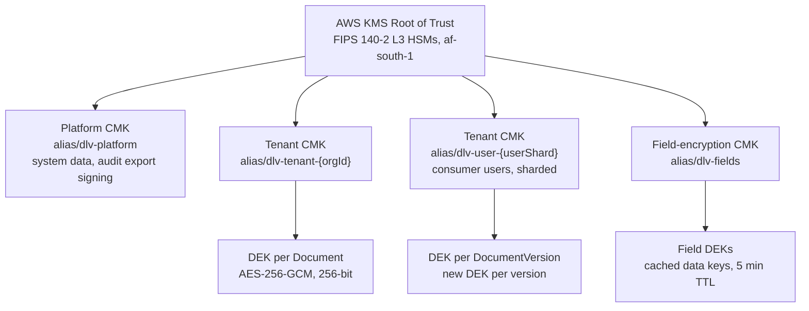
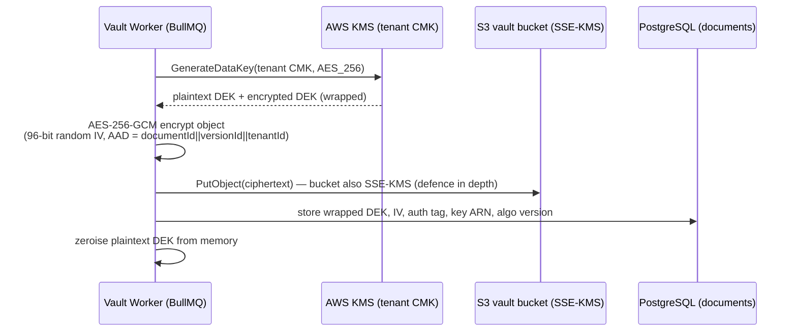
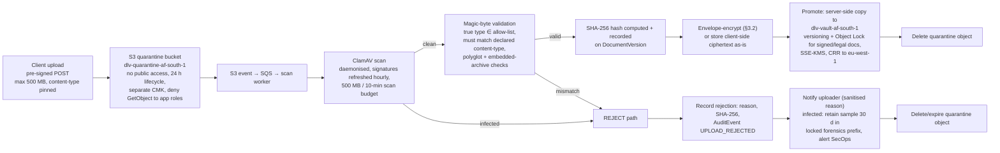
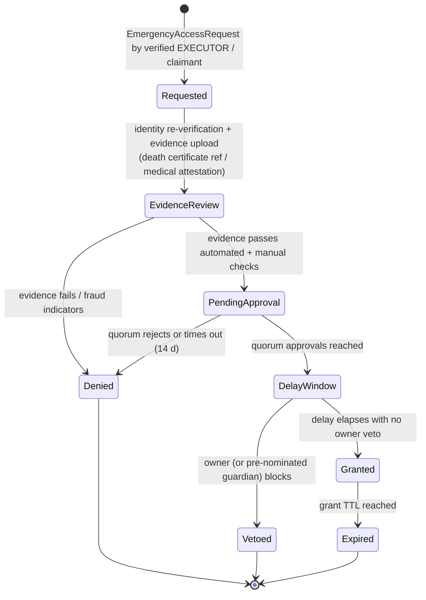

# Security Architecture — Digital Legacy Vault (DLV)

| Document control | |
|---|---|
| Version | 1.0.0 |
| Date | 2026-07-05 |
| Status | Draft for Review |
| Owner | Security Team |
| Classification | Internal — Confidential |
| Related documents | `PROJECT_MEMORY.md` (§7 Security invariants), `docs/04-security/threat-model.md`, `docs/04-security/risk-register.md` |

> This document is the implementation-level security architecture for Digital Legacy Vault (DLV). It operationalises the eight security invariants in `PROJECT_MEMORY.md` §7. Any conflict between this document and PROJECT_MEMORY is resolved in favour of PROJECT_MEMORY.

---

## 1. Zero-trust principles, applied concretely

DLV assumes no implicit trust based on network location, device, or prior authentication. The five principles below are mapped to concrete mechanisms in this stack (Next.js 15 / NestJS 11 / EKS / AWS af-south-1 primary, eu-west-1 DR).

| Principle | Concrete implementation in DLV |
|---|---|
| **Verify explicitly** | Every request re-evaluated: JWT access token (RS256, 15 min, verified against JWKS) + CASL ABAC policy check per resource per request. No "authenticated = authorised". Service-to-service calls inside EKS use mTLS via AWS App Mesh sidecar certificates rotated every 24 h. |
| **Least privilege** | Deny-by-default authorization (invariant §7.8): every REST/GraphQL resolver is decorated with an explicit `@Policy()` guard; CI fails if an endpoint lacks one (custom ESLint rule + e2e policy-coverage test). IAM via IRSA per service account — no node-level IAM permissions beyond EKS bootstrap. |
| **Assume breach** | Per-tenant KMS key hierarchy limits blast radius of any single key compromise to one tenant. Hash-chained audit log makes tampering evident. Network segmentation (§8.1) means a compromised pod cannot reach RDS outside its security-group pairing. GuardDuty + Security Hub for detection (§10). |
| **Micro-segmentation** | Kubernetes NetworkPolicies default-deny per namespace; each bounded context (`identity`, `vault`, `estate`, `signature`, `audit`, …) is a separate namespace with explicit allow rules only for declared dependencies. |
| **Continuous verification** | Session risk re-scored on every token refresh (§2.5); step-up auth (passkey or TOTP re-prompt) forced for sensitive operations regardless of session age: emergency-access approval, Client-Encrypted Vault key operations, beneficiary changes, API key creation, export of a full vault. |

**Sensitive-operation list requiring step-up auth (canonical):** emergency access approve/deny, `EmergencyAccessGrant` issuance, executor/beneficiary add or change, Client-Encrypted Vault unlock, Shamir share operations, signature ceremony start, `ApiKey` create/rotate, vault export, account e-mail/phone change, plan cancellation with data deletion.

---

## 2. Identity security

### 2.1 Authentication factors

| Factor | Implementation |
|---|---|
| Passkeys (primary) | WebAuthn Level 2, platform + roaming authenticators. `residentKey: preferred`, `userVerification: required`. Attestation `none` accepted for consumer users; `direct` attestation with AAGUID allow-list enforced for platform roles (`SYSTEM_ADMIN`, `SUPER_ADMIN`, `AUDITOR`, `SUPPORT_AGENT`) — hardware-backed keys only. |
| TOTP 2FA | RFC 6238, 30 s step, SHA-1 6-digit (compatibility), ±1 step drift window. Secret generated server-side (160-bit), shown once as QR, stored field-level encrypted (AES-256-GCM column, §3.4). 10 single-use recovery codes (Argon2id-hashed) issued at enrolment. |
| Password (fallback) | Argon2id: memory 64 MiB, iterations 3, parallelism 4. zxcvbn score ≥ 3 required; checked against Have-I-Been-Pwned k-anonymity range API at set/change time. Passwords are a fallback, not the promoted path — onboarding pushes passkey enrolment. |
| OAuth2 / SSO | Social + enterprise OIDC at launch; SAML reserved (PROJECT_MEMORY §3). External identities always mapped to a local `User`; MFA policy still enforced locally for sensitive operations unless the IdP asserts `amr` containing `hwk` or `mfa`. |

### 2.2 Tokens and sessions

- **Access token:** JWT, RS256, 15 min TTL, verified against JWKS endpoint (`/.well-known/jwks.json`). Keys rotated every 90 days with 7-day overlap; `kid` header mandatory. Claims: `sub` (UUIDv7), `sid` (Session id), `org`, `roles`, `amr`, `auth_time`, `risk_tier`.
- **Refresh token:** opaque 256-bit random, httpOnly + Secure + `SameSite=Strict` cookie, path-scoped to `/api/v1/auth/refresh`. Server-side record in Redis 7 keyed by token hash (SHA-256), linked to `Session` and `Device` entities.
- **Session entity:** absolute lifetime 30 days (consumer) / 12 h (platform roles); idle timeout 24 h / 30 min respectively. All sessions listable and revocable by the user ("active sessions" screen); revocation deletes the Redis record, which invalidates refresh immediately and access tokens within ≤ 15 min.

### 2.3 Refresh rotation + reuse detection

1. Every refresh call rotates: old token marked `rotated` (kept 30 days for forensics), new token issued, both linked to the same token-family id.
2. **Reuse detection:** presentation of a token in state `rotated` or `revoked` ⇒ the entire token family is revoked, all sessions for that `Device` terminated, `AuditEvent` `AUTH_REFRESH_REUSE_DETECTED` written, user notified via SES e-mail + Twilio SMS, and the account flagged for elevated risk scoring (§2.5) for 72 h.
3. Refresh endpoint rate-limited separately (§7.1) and exempt from CDN caching.

### 2.4 Device fingerprinting

- Client computes a stable fingerprint (UA-CH platform/model, screen class, timezone, language, canvas-free entropy sources only — no canvas/WebGL fingerprinting, to stay POPIA-proportionate) and sends it on login/refresh.
- Server binds fingerprint hash to the `Device` entity. New device ⇒ e-mail notification + risk-score input. Fingerprint mismatch on an existing session ⇒ refresh denied, re-authentication required.
- Fingerprints are hashed (SHA-256, per-tenant pepper from Secrets Manager) before storage; raw signals are not persisted.

### 2.5 Risk scoring at login + step-up

Login risk score (0–100) computed synchronously from weighted signals; weights are configuration, initial values stated here as the working assumption:

| Signal | Weight |
|---|---|
| New device (no `Device` record) | +25 |
| New country vs. 90-day history (GeoIP) | +20 |
| Impossible travel (> 900 km/h between events) | +40 |
| IP on threat list (GuardDuty threat intel / AbuseIPDB ≥ 75) | +30 |
| Tor / anonymising proxy exit | +25 |
| Recent refresh-reuse flag (§2.3) | +30 |
| Failed attempts in last hour (per account) | +5 each, cap +25 |
| Time-of-day anomaly vs. profile | +10 |

**Tiers:** 0–29 allow; 30–59 **step-up** (passkey or TOTP challenge even if "remember this device" set); 60–79 step-up + e-mail confirmation link; ≥ 80 block + notify + require support-verified recovery. Score and tier recorded on the `Session` (`risk_tier` claim) and in `AuditEvent`.

### 2.6 Account recovery

- Standard tier: e-mail verification + mandatory 24 h delay + notification to all channels; recovery cannot remove 2FA in the same flow.
- Client-Encrypted Vault: **no server-side recovery possible by design**. Recovery only via Shamir secret-sharing among trustees (§3.6). UI communicates this at enrolment with explicit `Consent` record.

---

## 3. Cryptography

### 3.1 TLS 1.3 configuration

- **TLS 1.3 only** (invariant §7.1) at CloudFront and ALB: policy `TLSv1.3` exclusively; ciphersuites `TLS_AES_256_GCM_SHA384`, `TLS_AES_128_GCM_SHA256`, `TLS_CHACHA20_POLY1305_SHA256`. TLS 1.2 is not offered. 0-RTT early data **disabled** (replay risk on non-idempotent endpoints).
- HSTS: `max-age=63072000; includeSubDomains; preload` (submitted to preload list).
- Certificates: ACM-managed, ECDSA P-256 primary with RSA-2048 fallback chain, auto-renewal; CAA records restrict issuance to Amazon.
- Internal: pod-to-pod mTLS (App Mesh, SPIFFE-style SVIDs, 24 h rotation); RDS connections `sslmode=verify-full`; ElastiCache Redis with TLS in-transit encryption enabled.

### 3.2 Envelope encryption — Standard tier

Invariant §7.2: per-document DEK (AES-256-GCM) wrapped by KMS CMK, per-tenant hierarchy, annual + on-demand rotation.

**Key hierarchy:**



**Encrypt flow (upload promote step, §4):**



**Decrypt flow:** service passes wrapped DEK to KMS `Decrypt` with encryption context `{tenantId, documentId}`; KMS key policy requires matching context — a wrapped DEK exfiltrated from the DB cannot be unwrapped for a different tenant/document. Plaintext DEKs are never cached for vault objects (field keys only, §3.4).

**Rotation:** KMS annual automatic rotation on all CMKs (old backing keys retained for decrypt). On-demand rotation (compromise, tenant request, offboarding): new CMK issued, background BullMQ job re-wraps all DEKs (re-wrap only — objects are not re-encrypted, ~ms per document), old CMK scheduled for deletion after 30-day pending window. Rotation events are `AuditEvent`s.

### 3.3 Tiered encryption model

| | Standard tier (default) | Client-Encrypted Vault (opt-in, per document) |
|---|---|---|
| Encryption location | Server-side envelope (§3.2) | Client-side AES-256-GCM before upload |
| Key custody | KMS, per-tenant CMK | User only — key never leaves user custody |
| OCR / AI / search | Yes (Textract / Claude via AiGateway) | **Disabled** — server never sees plaintext; AI never receives content (PROJECT_MEMORY §2.8) |
| Emergency access | Via emergency workflow (§11) | Only if owner pre-provisioned Shamir shares to trustees |
| Recovery | Standard account recovery | Shamir secret-sharing only (§3.6) |
| Server stores | Ciphertext + wrapped DEK | Ciphertext + user-wrapped key blob (opaque) + minimal metadata |

Client-side crypto: WebCrypto AES-256-GCM; per-document CEK derived nowhere server-visible; CEK wrapped with a Vault Master Key derived from the user's vault passphrase via Argon2id (64 MiB, t=3, p=4, per-user salt) — passphrase distinct from login password, never transmitted. Server stores only the wrapped-CEK blob and Argon2 parameters.

### 3.4 Field-level encryption (PII columns)

Invariant §7.3. AES-256-GCM at the application layer (Prisma middleware / `@Encrypted()` transformer) using data keys from `alias/dlv-fields` (cached ≤ 5 min, per-purpose encryption context).

Encrypted columns (canonical list): `users.id_number_token_ref` (see §3.5), `users.tax_number`, `users.phone_e164`, `beneficiaries.contact_details`, `executors.contact_details`, `emergency_access_requests.claimant_identity`, `documents.crypto_recovery_ref`, `users.totp_secret`, `signatures.signer_identity_evidence`, `emergency_contacts.*` contact fields.

Searchable equality (e.g., phone lookup) uses a separate HMAC-SHA-256 blind index column with a dedicated Secrets Manager key — never the encryption key.

### 3.5 Tokenisation of ID numbers

SA ID numbers (and passport numbers) are tokenised, not merely encrypted:

1. `identity` service sends the raw ID number to an internal **token service** (own namespace, own CMK, own RDS schema, network-isolated; only `identity` and `estate` may call it).
2. Token service stores the AES-256-GCM-encrypted value in its private table and returns a random UUIDv7 token.
3. Application tables store only the token. Detokenisation is a scoped, audited API (`AuditEvent` per call) permitted only for: signature ceremonies (identity evidence), death-verification workflow, and lawful regulator requests approved by `SUPER_ADMIN` + `AUDITOR` dual control.
4. Display uses format-preserving masking (`900101*******`) rendered by the token service — the app never holds the full value.

This shrinks POPIA scope: a full application-DB dump yields no ID numbers.

### 3.6 Shamir secret-sharing recovery (Client-Encrypted Vault)

- Scheme: SSS over GF(256), default threshold **3-of-5** (owner-configurable, minimum 2-of-3) among designated trustees (`Executor`/`Beneficiary`/nominated contacts).
- Shares are generated **client-side** from the Vault Master Key; each share is encrypted to the trustee's registered public key (X25519 sealed box) before the server ever sees it. Server stores only trustee-encrypted share blobs.
- Reconstruction requires: (a) an approved `EmergencyAccessGrant` (§11) **or** the owner's live step-up-authenticated request, (b) threshold trustees each decrypting their share client-side and submitting to a client-side reconstruction ceremony — the server relays blobs but never sees ≥ threshold plaintext shares.
- Every share issuance, refresh, and use is an `AuditEvent`; trustee changes regenerate all shares (old shares invalidated by re-keying the Vault Master Key wrap).

---

## 4. Upload security pipeline

Invariant §7.5. All ingress objects (uploads, e-mail-in, API) traverse the same pipeline.



Rules:

- Allow-list of true types: PDF, PNG, JPEG, HEIC, TIFF, DOCX, XLSX, TXT, common video/audio for legacy messages. Executables, scripts, HTML, and macro-enabled Office formats are rejected outright.
- ClamAV timeout/failure ⇒ **fail closed**: object stays quarantined, retried 3×, then rejected with `SCAN_UNAVAILABLE` and SecOps alert.
- The vault bucket accepts writes **only** from the scan worker's IRSA role (bucket policy condition on `aws:PrincipalArn`); the API can never write to it directly.
- Hash recorded pre-encryption (plaintext hash, Standard tier) for integrity + dedup + legal evidence; for Client-Encrypted objects, hash is of the ciphertext (server cannot see plaintext) and the client additionally records a plaintext hash inside the encrypted metadata.
- Downloads: `Content-Disposition: attachment`, `X-Content-Type-Options: nosniff`, served from a cookie-less media domain via CloudFront signed URLs (≤ 5 min TTL).

---

## 5. Immutable hash-chained audit log

Invariant §7.4.

**Write path:** every security-relevant action emits an `AuditEvent` (UUIDv7 id, `occurred_at` timestamptz UTC, actor, actor IP, `Session` id, action enum, resource type/id, tenant, outcome, canonicalised JSON detail).

**Hash chain:** `event.hash = SHA-256(prev_hash || canonical_json(event))` per tenant chain; genesis event per tenant anchors to the platform chain. Computed inside the same DB transaction as the business write (transactional outbox) so no event can be lost or reordered.

**Immutability layers:**

1. Postgres: `audit_events` table with `REVOKE UPDATE, DELETE` from all application roles; only `INSERT` granted. A trigger raises on any UPDATE/DELETE attempt (defence against ORM bugs).
2. Hourly export of sealed segments (JSONL + segment Merkle root) to S3 with **Object Lock, compliance mode**, retention 7 years — not deletable even by `SUPER_ADMIN` or AWS account root.
3. Segment roots signed with the platform CMK (KMS `Sign`, RSA-PSS) and cross-replicated to eu-west-1.

**Verification:** nightly job re-walks each tenant chain and compares against sealed segment roots; any discontinuity pages SecOps (P1). `AUDITOR` role has a read-only verification console. Chain proofs are exportable for legal evidence (supports the wills/estates evidence-preservation positioning).

**Clock integrity:** all nodes on Amazon Time Sync; audit writes reject client-supplied timestamps.

---

## 6. Application security

### 6.1 OWASP Top 10 (2021) → concrete mitigations

| OWASP 2021 | DLV mitigation |
|---|---|
| A01 Broken Access Control | Deny-by-default `@Policy()` guard on every REST route and GraphQL resolver (CASL ABAC: resource + attribute + relationship, e.g. `EXECUTOR` scoped to a specific `Vault`). IDOR prevented by policy checks on the loaded entity, never on the raw id; UUIDv7 ids are non-enumerable but never relied on as a control. Policy-coverage e2e test in CI fails the build on any unguarded endpoint. |
| A02 Cryptographic Failures | §3 in full: TLS 1.3-only, envelope encryption, field-level AES-256-GCM, tokenisation, KMS custody, no home-rolled crypto (WebCrypto + AWS Encryption SDK + libsodium only). |
| A03 Injection | Prisma parameterised queries exclusively; `$queryRaw` banned by ESLint rule except in an allow-listed, reviewed module. zod (frontend + BFF) and class-validator (NestJS DTOs, `whitelist: true`, `forbidNonWhitelisted: true`) on every input. OS command execution banned in app code. GraphQL: depth limit 8, complexity budget 1 000, introspection disabled in prod. |
| A04 Insecure Design | This document + `threat-model.md`; abuse-case reviews (fake death claims, coercion) are release-gate checklist items for the `estate` context; security review mandatory for any change to auth, crypto, estate, or signature modules. |
| A05 Security Misconfiguration | Terraform-only infrastructure (no console changes; drift detection nightly), AWS Config conformance packs, CIS EKS benchmark via kube-bench in CI, security headers (§6.2), default-deny NetworkPolicies, prod GraphQL introspection off, NestJS error filter returns RFC 9457 problem+json without stack traces. |
| A06 Vulnerable & Outdated Components | Renovate auto-PRs; `pnpm audit` + Snyk in CI (fail on high/critical); Trivy image scanning in pipeline + ECR scan-on-push + Inspector continuous; base images distroless, rebuilt weekly; SBOM (CycloneDX) per release. |
| A07 Identification & Authentication Failures | §2 in full: passkeys, TOTP, Argon2id, rotation + reuse detection, risk-based step-up, lockout with exponential backoff (§7.2), breached-password screening. |
| A08 Software & Data Integrity Failures | Signed commits required on `main`; GitHub Actions with OIDC to AWS (no stored cloud keys); provenance attestation (SLSA-aligned) on images; Argo CD syncs only signed, digest-pinned images admitted by policy (§8.5); Subresource Integrity on the few third-party scripts (Stripe.js only); lockfile integrity enforced. |
| A09 Security Logging & Monitoring Failures | §5 audit chain + §10 detection stack; auth failures, policy denials, and admin actions all logged with alert thresholds; logs shipped to CloudWatch with 13-month retention, audit exports 7 years. |
| A10 SSRF | Outbound egress from app pods routed through a proxy with allow-list (Stripe, Twilio, Anthropic API, AWS endpoints); webhook/URL fetch features resolve DNS then re-validate the resolved IP against RFC 1918 / link-local / 169.254.169.254 deny-list (rebinding-safe: connect to the validated IP, SNI/Host set explicitly); IMDSv2 required with hop limit 1; VPC endpoints for AWS services keep S3/KMS/Secrets traffic off the internet. |

### 6.2 Security headers (canonical set, served by Next.js middleware + ALB)

```
Content-Security-Policy: default-src 'self'; script-src 'self' 'nonce-{request-nonce}' https://js.stripe.com; style-src 'self' 'unsafe-inline'; img-src 'self' data: blob: https://*.dlv-cdn.example; font-src 'self'; connect-src 'self' https://api.stripe.com wss://api.digitallegacyvault.example; frame-src https://js.stripe.com; frame-ancestors 'none'; object-src 'none'; base-uri 'self'; form-action 'self'; upgrade-insecure-requests; report-to csp-endpoint
Strict-Transport-Security: max-age=63072000; includeSubDomains; preload
X-Content-Type-Options: nosniff
X-Frame-Options: DENY
Referrer-Policy: strict-origin-when-cross-origin
Permissions-Policy: camera=(self), microphone=(), geolocation=(), payment=(self "https://js.stripe.com"), usb=(), interest-cohort=()
Cross-Origin-Opener-Policy: same-origin
Cross-Origin-Embedder-Policy: credentialless
Cross-Origin-Resource-Policy: same-site
Cache-Control: no-store  (all authenticated API responses)
```

Notes: CSP is nonce-based (no `unsafe-inline` for scripts); `camera=(self)` is required for the signature ceremony's identity-evidence capture. CSP reports flow to a `report-to` endpoint monitored in CloudWatch.

### 6.3 Output encoding, CSRF, other controls

- **Output encoding:** React 19 auto-escaping; `dangerouslySetInnerHTML` banned by ESLint except in one reviewed rich-text renderer using DOMPurify (allow-list profile). All user-supplied filenames/metadata HTML-encoded server-side in notification templates (SES/Twilio) to prevent template injection.
- **CSRF:** primary defence is `SameSite=Strict` auth cookies + custom `X-DLV-CSRF` double-submit token (per-session random, validated on every state-changing request); `Origin`/`Sec-Fetch-Site` header validation as backstop. GraphQL mutations require the same token. Pre-signed S3 POST uploads carry single-use policy documents.
- **File download safety:** §4; secure links (`SecureLink`) are single-audience, expiring, optionally PIN-protected, and fully audited.
- **Input validation:** zod schemas shared via the monorepo `packages/contracts` package so frontend and backend validate identically; class-validator DTOs are generated from the same source to prevent drift.

---

## 7. API security

### 7.1 Rate limiting tiers (Redis sliding-window, keyed by principal, fallback to IP; WAF layer above)

| Tier | Scope | Limit |
|---|---|---|
| Auth endpoints | per IP + per account | login 10/min/IP, 20/h/account; refresh 30/h/session; password reset 3/h/account; TOTP verify 5/5 min |
| Anonymous | per IP | 60 req/min |
| REGISTERED_USER | per user | 300 req/min |
| PREMIUM_USER / FAMILY_ADMIN | per user | 600 req/min |
| Organisation API (`ApiKey`) | per key | 1 200 req/min, burst 2 000; monthly quota per `Plan` |
| Upload initiation | per user | 30/h (consumer), 300/h (org) |
| Expensive ops (export, AI, OCR) | per user | 10/h, queued via BullMQ with per-tenant fairness |

Responses use RFC 9457 problem+json with `429`, `Retry-After`, and `RateLimit-*` headers.

### 7.2 Brute-force lockout with exponential backoff

Per-account failed-auth counter (Redis): after 5 failures ⇒ 1 min lock; then 2, 4, 8 … doubling to a 24 h cap; counter resets on success or 24 h quiet. Lockout responses are indistinguishable from bad-credential responses (no user enumeration; identical timing via constant-time compare + response padding). At 10 failures the owner is notified; at 20, the account requires step-up on next success. CAPTCHA (privacy-preserving, e.g. Turnstile-class) inserted at risk score ≥ 30 or after 3 failures. Per-IP dampening runs in parallel so a distributed attack on one account still trips the account lock, and one IP spraying many accounts trips WAF rules.

### 7.3 Bot detection

Layered: AWS WAF Bot Control (common + targeted) on CloudFront; JS/behavioural challenge on auth and signup; velocity anomaly rules (signup bursts per IP/ASN, share-link scraping patterns); honeypot form fields; alerting into Security Hub. Legitimate integrators use `ApiKey`s and are exempted by key, never by IP.

### 7.4 API key scoping (`ApiKey` entity)

- Format `dlv_live_…` / `dlv_test_…` (prefix + 256-bit random); only SHA-256 hash stored; shown once at creation.
- Mandatory scopes (e.g. `documents:read`, `documents:write`, `shares:create`, `webhooks:manage`) — no wildcard scope exists. Keys are tenant-bound and can be IP-CIDR-restricted and expiry-dated (default 12 months, warning at 30 days).
- Rotation endpoint supports dual-validity overlap (24 h). All key usage is audit-logged; anomalous usage (new ASN, scope-denied spikes) raises alerts. Webhook payloads signed (HMAC-SHA-256, `X-DLV-Signature` with timestamp, 5-min tolerance) — invariant-consistent with §7.7: key material lives in Secrets Manager.

---

## 8. Infrastructure security

### 8.1 Network segmentation

- VPC per environment (`dev`/`staging`/`prod`), af-south-1 primary, eu-west-1 DR. Three subnet tiers × 3 AZs: **public** (ALB, NAT only), **private-app** (EKS nodes), **private-data** (RDS, ElastiCache, token service). No public IPs on nodes or data tier.
- Ingress path: Route 53 → CloudFront (+ Shield, WAF) → ALB → EKS ingress. Origin locked: ALB accepts only CloudFront prefix-list source + custom origin-verify header secret.
- Egress: NAT + egress proxy allow-list (§6.1 A10); VPC endpoints (gateway: S3, DynamoDB; interface: KMS, Secrets Manager, SQS, ECR, CloudWatch, STS) so control-plane traffic never leaves AWS.

### 8.2 Security-group philosophy

Deny-by-default, **pairwise references, never CIDRs** for internal traffic: `sg-rds` ingress 5432 only from `sg-eks-nodes`; `sg-redis` 6379 only from `sg-eks-nodes`; `sg-alb` 443 only from CloudFront prefix list. No `0.0.0.0/0` ingress anywhere except CloudFront's own edge. No SSH: node access via SSM Session Manager only (audited, no inbound port). Terraform is the sole author; AWS Config rule flags any out-of-band SG change (auto-remediation reverts + alerts).

### 8.3 Workload identity — IRSA, no long-lived credentials

- Every service account uses **IRSA** (IAM Roles for Service Accounts): the `vault` service role can `GenerateDataKey`/`Decrypt` only on tenant CMK aliases and read/write only its bucket prefixes; `notification` can only call SES/SNS; `audit` alone can write the audit export prefix.
- **Zero long-lived credentials anywhere:** no IAM users with access keys (SCP blocks `iam:CreateAccessKey`); CI uses GitHub Actions OIDC federation; developers use IAM Identity Center SSO (max 8 h sessions); cross-region replication uses service roles.
- Secrets: AWS Secrets Manager exclusively (invariant §7.7), synced to pods via External Secrets Operator; automatic rotation for RDS creds (30 d) and third-party keys (Stripe/Twilio/Anthropic, 90 d or on staff departure). Git history scanned by gitleaks in CI + pre-commit.

### 8.4 Image and cluster hardening

- Images: distroless base, non-root (`runAsNonRoot`, read-only root FS, all capabilities dropped, seccomp `RuntimeDefault`); Trivy scan in CI (fail high/critical), ECR scan-on-push, Inspector continuous rescans of running images.
- EKS: private API endpoint; control-plane audit logs on; nodes in private subnets with IMDSv2 hop-limit 1; Bottlerocket AMIs; kube-bench CIS checks in pipeline.

### 8.5 Admission policies (Kyverno)

Cluster-enforced (`enforce` mode, prod): images only from the project ECR registries and only by **digest**; Cosign signature verification against the CI signing key; no privileged pods, no hostPath/hostNetwork/hostPID; resource limits mandatory; `latest` tag rejected; namespaces must carry a bounded-context owner label; NetworkPolicy must exist before a namespace admits workloads. Argo CD is the only principal with write access to workloads (GitOps; humans have read-only prod kubectl, break-glass role behind step-up + audit).

---

## 9. Data protection operations

- S3 vault buckets: versioning on, Object Lock **compliance mode** for signed/legal documents (`Signature` seals, executed directives) with retention aligned to legal-hold policy; lifecycle to Glacier; CRR to eu-west-1 (encrypted with destination-region keys).
- Data residency: SA customer data pinned primary to af-south-1 (PROJECT_MEMORY §2.3); cross-border replication to eu-west-1 is documented as a POPIA §72 transfer with appropriate safeguards (see compliance mapping §12 and risk register R-016).
- Backups: RDS Multi-AZ + PITR (35 d) + cross-region snapshots; quarterly restore tests; backup vault access isolated (separate account, no delete rights from prod).
- Deletion: POPIA/GDPR erasure implemented as crypto-shredding where Object Lock or `LegalHold` prevents physical deletion — destroying the wrapped DEK renders ciphertext unrecoverable; the deletion decision itself is an `AuditEvent`.

---

## 10. Detection & response

### 10.1 Telemetry stack

- **CloudTrail:** all regions, org trail, log-file validation on, delivered to a locked logging account bucket (Object Lock).
- **GuardDuty:** enabled af-south-1 + eu-west-1 incl. EKS Protection, S3 Protection, Malware Protection.
- **Security Hub:** aggregator; CIS AWS Foundations + AWS Foundational Security Best Practices standards; findings routed to SecOps via EventBridge → PagerDuty-class alerting + Slack.
- **Inspector** (ECR/EC2/Lambda), **AWS Config** (drift), CloudWatch metrics/alarms, application `AuditEvent` stream mirrored to the SIEM index.

### 10.2 Alerting runbook triggers (P1 unless noted)

| Trigger | Source | Initial action |
|---|---|---|
| Audit hash-chain discontinuity | nightly verifier | P1: freeze audit export role, snapshot DB, invoke IR |
| GuardDuty High/Critical (e.g. `CredentialAccess:IAMUser/AnomalousBehavior`, EKS findings) | GuardDuty | P1: isolate workload (NetworkPolicy quarantine label), rotate IRSA role creds |
| Refresh-token reuse spike (> 5/h platform-wide) | auth service | P2: review token families, check for infra MITM |
| Emergency-access request on high-profile vault, or > 3 requests/24 h platform-wide | estate service | P2: manual review before timer expiry |
| ClamAV detection rate anomaly or scanner offline > 15 min | upload pipeline | P2 (pipeline fails closed) |
| Root account use, SCP/ SG out-of-band change | CloudTrail/Config | P1 |
| Detokenisation API called outside allow-listed flows | token service | P1 |
| Mass-download pattern (> 50 documents/10 min/user) | vault service | P2: soft-lock downloads, verify user |

### 10.3 Incident response phases

1. **Preparation** — this doc, runbooks per trigger above, quarterly tabletop (one scenario per year must be a fake-death/emergency-access abuse case), on-call rota, pre-agreed outside counsel + forensics retainer.
2. **Detection & analysis** — triage in Security Hub; severity matrix (P1: confirmed data exposure, chain tamper, key compromise; P2: contained attempt; P3: policy violation). Evidence preserved to the locked forensics bucket (Object Lock).
3. **Containment** — workload quarantine label (NetworkPolicy isolates pod), IRSA role policy detach, KMS key policy lockdown, global session revocation switch, per-tenant feature freeze.
4. **Eradication & recovery** — rebuild from signed images (never patch-in-place), rotate all secrets in scope (Secrets Manager rotation jobs), on-demand CMK rotation (§3.2), verified-clean restore.
5. **Post-incident** — blameless review within 5 business days; risk register update; control gap → mitigation backlog.

### 10.4 Breach notification duties

| Regime | Duty | DLV commitment |
|---|---|---|
| **POPIA §22** | Notify the Information Regulator and affected data subjects **"as soon as reasonably possible"** after discovering reasonable grounds to believe personal information was accessed/acquired by an unauthorised person; notification must enable data subjects to take protective measures. | Internal SLA: Regulator + data-subject notification decision within 72 h of confirmation; notification content pack (nature, likely consequences, measures taken, recommended data-subject steps, identity of unauthorised party if known) templated in the IR runbook. Responsible Party is Stellr SA; Information Officer is the accountable role. |
| **GDPR Art. 33/34** | Supervisory authority within **72 hours** of awareness unless unlikely to risk rights/freedoms; data subjects without undue delay when high risk. | Same 72 h internal clock; EU customers routed via the lead supervisory authority determined at EU expansion; Art. 33(5) internal breach register maintained (feeds from the incident tracker). |
| Contractual (B2B orgs) | Per DPA/BAA terms | Default 48 h customer notification for confirmed incidents affecting their tenant. |

The hash-chained audit log (§5) is the primary forensic record supporting "what was accessed, by whom, when" in any notification.

---

## 11. Emergency-access security controls

Invariant §7.6: **multi-party approval + time delay + full audit + owner notification — always, no exceptions.**



Controls:

- **Requester verification:** requester must be a registered `Executor`/`Beneficiary` with prior owner-established relationship, step-up authenticated; claimant identity captured field-level encrypted; document evidence (e.g. death certificate) goes through the §4 upload pipeline and human review by trained staff (dual review for high-value vaults). Home Affairs death-record verification integration is a roadmap control; until then manual verification is mandatory (assumption recorded in risk register R-006).
- **Multi-party approval:** quorum configured by the owner in life (default: 2 approvers from the owner's nominated circle + 1 DLV verification officer for death claims). A single actor can never approve their own request; `SUPPORT_AGENT` and `SYSTEM_ADMIN` cannot be approvers.
- **Mandatory delay:** default **72 h**, owner-configurable 24 h – 30 days (FR-EST-003); **7 days** default for death claims with a non-negotiable 48 h floor. Exception: requests scoped solely to `MEDICAL_DIRECTIVE`/`LIVING_WILL` may be expedited to **1 h** when approved by two verified medical professionals (`DOCTOR`/`HOSPITAL_ADMIN`), since clinical urgency defeats a multi-day delay. During the window the owner is notified on **all** channels (SES e-mail, Twilio SMS + WhatsApp, push) at T0, T+50 %, T−12 h, with one-tap veto that also triggers a security review of the requester.
- **Scoped grant:** `EmergencyAccessGrant` is read-only, time-boxed (default 30 d), scoped to the document categories the owner pre-selected (e.g. `MEDICAL_DIRECTIVE` only for hospital flows via `DOCTOR`/`HOSPITAL_ADMIN` roles); `CRYPTO_RECOVERY` and Client-Encrypted documents require the Shamir ceremony (§3.6) in addition.
- **Evidence trail:** every state transition, approval identity, evidence document hash, notification dispatch/delivery receipt, and each document actually opened under the grant is an `AuditEvent` in the tamper-evident chain; a complete evidence bundle is exportable for the Master of the High Court / estate proceedings.

---

## 12. Compliance control mapping (requirement → control → evidence)

| # | Requirement | Control (this doc) | Evidence produced |
|---|---|---|---|
| C-01 | POPIA §19 security safeguards | §3 encryption, §8 infra, §6 appsec | Terraform state, KMS key policies, pen-test reports |
| C-02 | POPIA §22 breach notification | §10.4 runbook + IR phases | Incident records, notification templates, breach register |
| C-03 | POPIA §72 cross-border transfer (CRR to eu-west-1) | §9 residency controls, transfer safeguards documented | DPA clauses, replication config, Config rules |
| C-04 | POPIA §11/§18 consent & notification | `Consent` entity, granular consent UI, audit of consent changes | Consent records + `AuditEvent` chain |
| C-05 | GDPR Art. 32 security of processing | Whole document | ISO 27001 SoA cross-reference, control test results |
| C-06 | GDPR Art. 33/34 breach notification | §10.4 | Breach register, 72 h clock records in incident tracker |
| C-07 | GDPR Art. 17 erasure | §9 crypto-shredding + deletion workflow | Deletion `AuditEvent`s, DEK destruction logs |
| C-08 | ISO 27001 A.8.24 (crypto), A.8.15/16 (logging/monitoring), A.5.15–18 (access control) | §3, §5, §10, §2 | Key inventory, audit chain verifier reports, access reviews (quarterly) |
| C-09 | SOC 2 CC6 (logical access), CC7 (system ops) — certification target | §2, §6, §8, §10 | Same evidence set, mapped in SoA; SOC 2 readiness tracker |
| C-10 | HIPAA-ready: §164.312 technical safeguards (if US healthcare onboards, BAA-gated) | Encryption, audit controls, emergency-access procedures (§11 maps to HIPAA emergency access) | BAA template, safeguard mapping doc |
| C-11 | ECTA advanced electronic signatures (directives, mandates, consents — not wills execution) | `signature` context: SHA-256 digest, RFC 3161 trusted timestamp, signer identity + device evidence bundle, Object Lock storage | Signature evidence bundles, timestamp authority responses |
| C-12 | SA Wills Act 7 of 1953 positioning | UI disclaimers + product positioning as repository/drafting/evidence layer, not execution (PROJECT_MEMORY §2.2) | UI copy audit, legal review sign-off, `Consent` acknowledgement at will upload |
| C-13 | PCI DSS scope minimisation | Stripe-hosted payment fields; no PAN touches DLV systems | SAQ A attestation, CSP restricting frame/script to Stripe |
| C-14 | Audit integrity for estate evidence | §5 hash chain + Object Lock export | Chain verification reports, exportable proofs |

---

## 13. Assumptions introduced by this document

1. Numeric parameters not fixed in PROJECT_MEMORY (rate-limit values, risk-score weights, lockout curve, emergency-access delays of 72 h default / 7 d death claims with 48 h floor and 1 h medical-scope expedite, Shamir default 3-of-5, 500 MB upload cap, session lifetimes, retention periods) are stated here as initial production values, owned by the Security Team and tunable via configuration.
2. Service mesh mTLS (App Mesh), Kyverno admission control, External Secrets Operator, and an egress allow-list proxy are named as the concrete mechanisms satisfying PROJECT_MEMORY's EKS/Terraform/Secrets-Manager stack; substitutes with equivalent guarantees are acceptable if this document is updated first.
3. Home Affairs death-record verification is treated as a roadmap integration; manual dual review is the compensating control until then.
