# Threat Model — Digital Legacy Vault (DLV)

| Document control | |
|---|---|
| Version | 1.0.0 |
| Date | 2026-07-05 |
| Status | Draft for Review |
| Owner | Security Team |
| Classification | Internal — Confidential |
| Methodology | STRIDE per trust boundary + domain abuse cases |
| Related documents | `PROJECT_MEMORY.md`, `docs/04-security/security-architecture.md` (SA-§ refs below), `docs/04-security/risk-register.md` |

Scope: production system, af-south-1 primary / eu-west-1 DR, all bounded contexts (`identity`, `vault`, `sharing`, `estate`, `signature`, `notification`, `billing`, `audit`, `ai`, `admin`, `integration`). Review cadence: per release for `estate`/`signature`/auth changes; full refresh every 6 months or after any P1/P2 incident.

Rating scale: Likelihood and Impact each Low / Medium / High / Critical. Residual risk assessed after existing mitigations.

---

## 1. System decomposition and trust boundaries

```mermaid
flowchart TB
    subgraph TB0["TB-0: Untrusted Internet"]
        USER["End users<br/>owners, executors, beneficiaries"]
        PRO["Professional users<br/>LAWYER, DOCTOR, HOSPITAL_ADMIN,<br/>FINANCIAL_ADVISER"]
        API_CLIENT["Partner integrations<br/>ApiKey clients"]
        ATTACKER["Threat actors"]
    end

    subgraph TB1["TB-1: Edge — CloudFront + WAF + Shield"]
        CF["CloudFront + WAF + Bot Control"]
    end

    subgraph TB2["TB-2: Application VPC, private-app subnets, EKS"]
        WEB["Next.js 15 frontend / BFF"]
        APIGW["NestJS 11 API<br/>REST /api/v1 + GraphQL"]
        AUTH["identity service<br/>passkeys, TOTP, sessions"]
        VAULT["vault service<br/>documents, versions, OCR dispatch"]
        ESTATE["estate service<br/>emergency access, death verification"]
        SIGN["signature service"]
        SHARE["sharing service"]
        WORK["BullMQ workers<br/>scan, encrypt, notify, export"]
        AUDIT["audit service"]
    end

    subgraph TB3["TB-3: Data tier, private-data subnets"]
        PG[("PostgreSQL 16 RDS<br/>Prisma, field-level encryption")]
        REDIS[("Redis 7<br/>sessions, queues")]
        TOKSVC["Token service<br/>ID-number tokenisation<br/>isolated namespace + CMK"]
    end

    subgraph TB4["TB-4: Object storage + keys"]
        S3Q[("S3 quarantine bucket")]
        S3V[("S3 vault bucket<br/>Object Lock, SSE-KMS, CRR")]
        S3A[("S3 audit export<br/>Object Lock compliance")]
        KMS["AWS KMS<br/>per-tenant CMK hierarchy"]
        SM["Secrets Manager"]
    end

    subgraph TB5["TB-5: Third parties"]
        STRIPE["Stripe"]
        TWILIO["Twilio SMS / WhatsApp"]
        SES["AWS SES"]
        ANTH["Anthropic Claude API<br/>via AiGateway"]
        TEXTRACT["Textract / Tesseract OCR"]
        TSA["RFC 3161 timestamp authority"]
    end

    subgraph TB6["TB-6: Build & deploy plane"]
        GH["GitHub Actions, OIDC"]
        ECR["ECR signed images"]
        ARGO["Argo CD GitOps"]
        TF["Terraform"]
    end

    USER --> CF
    PRO --> CF
    API_CLIENT --> CF
    ATTACKER -.-> CF
    CF --> WEB
    CF --> APIGW
    WEB --> APIGW
    APIGW --> AUTH
    APIGW --> VAULT
    APIGW --> ESTATE
    APIGW --> SIGN
    APIGW --> SHARE
    AUTH --> PG
    AUTH --> REDIS
    VAULT --> PG
    VAULT --> S3Q
    WORK --> S3Q
    WORK --> S3V
    WORK --> KMS
    VAULT --> KMS
    AUTH --> TOKSVC
    ESTATE --> TOKSVC
    AUDIT --> PG
    AUDIT --> S3A
    WORK --> SES
    WORK --> TWILIO
    VAULT --> ANTH
    VAULT --> TEXTRACT
    SIGN --> TSA
    APIGW --> STRIPE
    APIGW --> SM
    GH --> ECR
    ECR --> ARGO
    ARGO --> TB2
    TF --> TB3
    TF --> TB4
```

**Trust boundary register**

| Boundary | Crossing | Primary controls (SA-§) |
|---|---|---|
| TB-0→TB-1 | Internet → edge | TLS 1.3-only, WAF, Shield, Bot Control (SA-§3.1, §7.3) |
| TB-1→TB-2 | Edge → app | Origin lock, JWT + CASL per request, rate limits (SA-§2, §7) |
| TB-2→TB-3 | App → data | SG pairing, mTLS, IRSA, field-level encryption, token service isolation (SA-§3.4–3.5, §8) |
| TB-2→TB-4 | App → storage/keys | Quarantine pipeline, KMS encryption context, bucket policies (SA-§3.2, §4) |
| TB-2→TB-5 | App → third parties | Egress allow-list proxy, webhook signing, AiGateway content rules (SA-§6.1-A10) |
| TB-6→TB-2 | Build → runtime | Signed digest-pinned images, Kyverno admission, GitOps-only writes (SA-§8.5) |
| Intra-TB-2 | Human roles crossing tenant/vault scopes | ABAC relationship checks, step-up auth, emergency-access workflow (SA-§2.5, §11) |

---

## 2. Asset inventory, ranked by sensitivity

| Rank | Asset | Location | Sensitivity rationale |
|---|---|---|---|
| 1 | `CRYPTO_RECOVERY` documents (seed phrases, recovery refs) | S3 vault / Client-Encrypted tier | Directly monetisable, irreversible theft |
| 2 | KMS CMK hierarchy + wrapped DEKs | KMS / PG | Compromise breaks confidentiality of everything in a tenant |
| 3 | Wills (`LAST_WILL`, `LIVING_WILL`), POA, medical directives | S3 vault (Object Lock) | Legal, medical, life-and-death consequence; integrity is paramount |
| 4 | ID/passport numbers + identity evidence | Token service | POPIA special weight, identity-theft fuel |
| 5 | Shamir share blobs + trustee registry | PG (encrypted blobs) | Path to Client-Encrypted content |
| 6 | Emergency-access workflow state + evidence (death certificates) | estate service / PG / S3 | Abuse grants access to ranks 1–4 |
| 7 | Audit chain (`AuditEvent` + sealed exports) | PG + S3 Object Lock | Legal evidence value; tamper destroys trust and estate-proceeding utility |
| 8 | Auth material: credentials, TOTP secrets, refresh families, passkey records | PG / Redis | Account takeover vector |
| 9 | Signature seals + evidence bundles | S3 Object Lock | ECTA enforceability depends on integrity |
| 10 | `MEDICAL_RECORD`, insurance, financial docs | S3 vault | Health/financial privacy |
| 11 | Beneficiary/executor relationship graph + contact PII | PG (field-encrypted) | Targeting data for social engineering |
| 12 | API keys, webhook secrets, infra secrets | Secrets Manager | Lateral movement |
| 13 | Billing data (Stripe refs, no PAN) | PG / Stripe | Lower — PAN never touches DLV |
| 14 | Availability of the service itself | — | Hospital/estate moments are time-critical |

---

## 3. Threat actor profiles

| Actor | Motivation | Capability | Typical access | Notes |
|---|---|---|---|---|
| **TA-1 External attacker** (financially motivated) | Crypto-recovery theft, extortion, resale of PII | Medium–High: phishing kits, credential stuffing, exploit purchase | None initially | Highest-volume actor; drawn by `CRYPTO_RECOVERY` concentration |
| **TA-2 Malicious insider** (engineer/DBA/SRE) | Curiosity, coercion, bribery, revenge | High: legitimate infra access, knows the controls | IRSA-scoped prod access, DB access paths | Mitigated by per-tenant CMK + encryption context, tokenisation, audit chain, no long-lived creds |
| **TA-3 Compromised executor/beneficiary** | Attacker who phished or coerced a trustee account | Medium: legitimate relationship-scoped access | Vault-relationship role | Dangerous because ABAC legitimately grants them paths to estate flows |
| **TA-4 Rogue org admin** (`COMPANY_ADMIN`/`HOSPITAL_ADMIN` misusing B2B tenancy) | Snooping on members/patients, data resale | Medium: org-scoped admin rights | Org tenant scope | Cannot cross tenant boundary; risk is intra-org overreach |
| **TA-5 Nation-state / advanced persistent** | Surveillance of targets, estate intelligence on persons of interest | Very high: supply chain, zero-days, lawful-access pressure | None initially | Drives supply-chain controls (TB-6) and Client-Encrypted Vault option |
| **TA-6 Grieving-relative social engineer** | A real relative (or fraudster posing as one) pressuring support/executors to open a vault "because the funeral is Friday" | Low technical, high emotional leverage | Public support channels, emergency-access request flow | The domain-specific actor: urgency + grief + plausible documents; support staff are the attack surface |
| **TA-7 Malicious support agent** (`SUPPORT_AGENT` abuse) | Same as TA-2 but via back-office tooling | Medium | Admin back-office, no vault content access by policy | Explicitly excluded from emergency-access approval (SA-§11) |

---

## 4. STRIDE analysis per trust boundary

### 4.1 TB-0/TB-1 — Internet edge

| ID | STRIDE | Asset | Attack scenario | L | I | Existing mitigations (SA-§) | Residual |
|---|---|---|---|---|---|---|---|
| T-001 | Spoofing | Auth material | Credential stuffing / password spraying against login using breached corpora | High | High | Passkey-first, Argon2id, HIBP screening, exponential lockout, CAPTCHA at risk ≥ 30, per-IP WAF rules (§2, §7.2) | Low |
| T-002 | Spoofing | User accounts | Phishing site harvests password + TOTP in real time (AiTM proxy) | High | High | Passkeys are origin-bound (phish-resistant); risk scoring flags new device/geo; step-up on sensitive ops (§2.1, §2.5) | Medium — TOTP-only users remain phishable; drive passkey adoption (M-01) |
| T-003 | Tampering | Session traffic | TLS downgrade / MITM on hostile networks | Low | High | TLS 1.3-only, HSTS preload, no 0-RTT (§3.1) | Low |
| T-004 | DoS | Availability | L7 flood on login/upload endpoints; hospital emergency-access flow degraded | Medium | High | Shield, WAF rate rules, CloudFront absorb, per-tier rate limits, queue backpressure (§7.1) | Low–Medium |
| T-005 | Info disclosure | User existence | Enumeration via login/reset/registration timing or responses | Medium | Medium | Uniform responses, constant-time compare, identical lockout messaging (§7.2) | Low |
| T-006 | Spoofing | SecureLink | Brute-forcing secure share links / QR tokens | Medium | High | 256-bit link tokens, expiry, optional PIN, single-audience binding, rate limiting, full audit (§6.3) | Low |

### 4.2 TB-1/TB-2 — Edge to application

| ID | STRIDE | Asset | Attack scenario | L | I | Existing mitigations | Residual |
|---|---|---|---|---|---|---|---|
| T-010 | Elevation | All vault data | IDOR: authenticated user manipulates documentId to read another vault (BOLA) | Medium | Critical | Deny-by-default CASL on loaded entity, policy-coverage CI gate, UUIDv7 non-enumerable (§6.1-A01) | Low |
| T-011 | Elevation | Estate flows | `BENEFICIARY` invokes executor-only endpoints (relationship-role confusion across vaults) | Medium | High | ABAC relationship checks scoped per Vault; role semantics tests; e2e authz matrix per role pair | Low–Medium — matrix must cover all 15 roles (M-02) |
| T-012 | Tampering | API integrity | Injection via metadata/search (SQLi, NoSQLi, GraphQL abuse) | Medium | High | Prisma parameterisation, zod + class-validator, GraphQL depth/complexity limits, introspection off (§6.1-A03) | Low |
| T-013 | Spoofing | Sessions | Stolen refresh token replay from exfiltrated cookie store | Medium | High | Rotation + family-wide reuse revocation, device-fingerprint binding, SameSite=Strict (§2.3–2.4) | Low |
| T-014 | Tampering | State-changing ops | CSRF against beneficiary-change or share-creation endpoints | Low | High | SameSite=Strict + double-submit token + Sec-Fetch-Site validation, step-up on beneficiary changes (§6.3, §1) | Low |
| T-015 | Info disclosure | Vault content | XSS via document title/notes rendered in dashboards or notification e-mails | Medium | High | React auto-escaping, DOMPurify-only rich text, nonce CSP, template encoding for SES (§6.2–6.3) | Low |
| T-016 | DoS | Workers | Expensive-op abuse: mass OCR/AI/export requests starve queues | Medium | Medium | Per-user expensive-op limits, BullMQ per-tenant fairness (§7.1) | Low |
| T-017 | Elevation | Org tenants | Rogue `COMPANY_ADMIN` (TA-4) exports all member data beyond org purpose | Medium | Medium | Org-scope ABAC, member-visible access logs, mass-download detection (§10.2), org DPA terms | Medium — add member-facing transparency report (M-03) |

### 4.3 TB-2/TB-3 — Application to data tier

| ID | STRIDE | Asset | Attack scenario | L | I | Existing mitigations | Residual |
|---|---|---|---|---|---|---|---|
| T-020 | Info disclosure | PG contents | Compromised app pod dumps the database | Medium | High | SG pairing, IRSA least privilege, field-level encryption, tokenised IDs, wrapped DEKs useless without KMS context (§3.2–3.5, §8) | Low–Medium |
| T-021 | Info disclosure | ID numbers | Insider (TA-2) queries token service to detokenise at scale | Low | Critical | Isolated namespace + CMK, caller allow-list, per-call audit, dual-control for regulator requests, P1 alert on out-of-flow calls (§3.5, §10.2) | Low |
| T-022 | Tampering | Audit chain | Insider deletes/rewrites `AuditEvent`s to hide access | Low | Critical | INSERT-only grants + trigger, hash chain, hourly Object Lock export, nightly verifier, signed segment roots (§5) | Low |
| T-023 | Spoofing | Sessions | Redis compromise mints/replays session records | Low | High | TLS + AUTH on ElastiCache, private-data subnet, token hashes only stored, JWT still required and signed (§2.2) | Low |
| T-024 | Repudiation | Estate actions | Executor denies having opened the will pre-grant; no proof either way | Medium | High | Per-document open events in tamper-evident chain, exportable proofs (§5, §11) | Low |
| T-025 | DoS | RDS | Runaway query/connection exhaustion from a buggy or hostile deployment | Medium | Medium | PgBouncer-style pooling, statement timeouts, Multi-AZ failover, admission-controlled resource limits | Low |

### 4.4 TB-2/TB-4 — Storage and keys

| ID | STRIDE | Asset | Attack scenario | L | I | Existing mitigations | Residual |
|---|---|---|---|---|---|---|---|
| T-030 | Tampering | Vault objects | Malware upload: crafted PDF/polyglot later served to executors or hospital staff | High | High | Quarantine → ClamAV → magic-byte allow-list → hash → promote; fail-closed; attachment-only downloads on cookie-less domain (§4) | Low–Medium — ClamAV misses novel malware; CDR evaluation queued (M-04) |
| T-031 | Info disclosure | All tenant docs | Misconfigured bucket or over-broad IRSA role exposes vault bucket | Low | Critical | Terraform-only + Config rules, block-public-access, bucket policy restricting writers, per-service roles, Security Hub checks (§8) | Low |
| T-032 | Info disclosure | DEKs/CMKs | Stolen wrapped DEKs unwrapped by attacker with partial KMS access | Low | Critical | Encryption context binding {tenantId, documentId}, per-tenant CMKs, key-policy least privilege, CloudTrail on all KMS calls (§3.2) | Low |
| T-033 | Tampering | Signed/legal docs | Attempt to alter an executed directive or signature seal after the fact | Low | Critical | S3 Object Lock compliance mode, versioning, SHA-256 + RFC 3161 timestamp in seal (§9, C-11) | Very Low |
| T-034 | Repudiation | Uploads | User claims "that will is not what I uploaded" | Medium | High | SHA-256 recorded at ingest, version history immutable, audit chain (§4, §5) | Low |
| T-035 | Info disclosure | Client-Encrypted docs | Server-side actor tries to read Client-Encrypted content | Low | Critical | Keys never leave user custody; server holds ciphertext + opaque wrapped blobs; AI/OCR disabled for tier (§3.3) | Very Low — residual is client-side malware (out of server control; user guidance M-05) |

### 4.5 TB-2/TB-5 — Third parties

| ID | STRIDE | Asset | Attack scenario | L | I | Existing mitigations | Residual |
|---|---|---|---|---|---|---|---|
| T-040 | Info disclosure | Vault content | SSRF from URL-fetch/webhook features pivots to IMDS or internal services | Medium | High | Egress allow-list proxy, DNS-rebinding-safe validation, IMDSv2 hop-limit 1, VPC endpoints (§6.1-A10) | Low |
| T-041 | Spoofing | Webhooks | Forged inbound Stripe/Twilio callbacks mutate billing or verification state | Medium | Medium | Signature verification (Stripe-Signature, Twilio X-Twilio-Signature), replay windows, idempotency keys | Low |
| T-042 | Info disclosure | Document text | Over-sending content to Claude/Textract; provider retains data | Low–Medium | High | AiGateway abstraction enforces tier rules (Client-Encrypted never sent), minimum-necessary prompts, zero-retention API terms, af-south-1 Tesseract fallback for residency-sensitive OCR | Medium — contractual assurance to be re-verified annually (M-06) |
| T-043 | Spoofing | Notifications | SMS/e-mail spoofing of DLV emergency-access notices (phishing owners into "vetoing" via fake link that harvests creds) | Medium | High | SPF/DKIM/DMARC p=reject, branded WhatsApp sender, veto links single-use + step-up before any credential entry, user education copy | Medium (M-07) |
| T-044 | DoS | Notifications | Twilio/SES outage suppresses owner notifications during an emergency-access delay window | Low | High | Multi-channel fan-out (e-mail + SMS + WhatsApp + push), delivery-receipt tracking; undeliverable-owner condition pauses the delay clock for death claims | Low |

### 4.6 TB-6 — Build & deploy plane

| ID | STRIDE | Asset | Attack scenario | L | I | Existing mitigations | Residual |
|---|---|---|---|---|---|---|---|
| T-050 | Tampering | Runtime code | Malicious dependency (npm supply chain) exfiltrates DEKs or content | Medium | Critical | Lockfile integrity, Renovate + Snyk gates, SBOM, egress allow-list catches call-home, distroless minimal surface (§6.1-A06/A08) | Medium — npm ecosystem risk is systemic (M-08) |
| T-051 | Elevation | Cluster | Compromised CI pushes unsigned image or Argo CD manifest tamper | Low | Critical | GitHub OIDC (no stored creds), Cosign signature + digest pinning enforced by Kyverno, GitOps-only writes, signed commits (§8.5) | Low |
| T-052 | Tampering | Infrastructure | Out-of-band console change weakens SGs/bucket policy | Low | High | SCPs, Config auto-remediation, Terraform drift detection, no human write access in prod (§8.2) | Low |

### 4.7 Intra-TB-2 — Human/role boundary (estate & emergency access)

| ID | STRIDE | Asset | Attack scenario | L | I | Existing mitigations | Residual |
|---|---|---|---|---|---|---|---|
| T-060 | Spoofing | Emergency access | Fraudulent death claim with forged death certificate (TA-1/TA-6) | Medium | Critical | Evidence pipeline + human dual review, quorum incl. owner circle, 7-day delay, all-channel owner notification with veto, requester must be pre-registered (§11) | Medium — until Home Affairs verification integration (M-09) |
| T-061 | Elevation | Vault content | Compromised executor account (TA-3) initiates emergency access | Medium | Critical | Step-up auth to request, quorum cannot be met by one actor, delay + owner veto, anomaly alerting on estate flows (§10.2, §11) | Low–Medium |
| T-062 | Info disclosure | Wills | Insider or `SUPPORT_AGENT` reads will content via back-office (TA-2/TA-7) | Low | Critical | Back-office has zero vault-content read path; content decryption requires vault-service IRSA + tenant CMK context; all admin actions audited; support excluded from approvals (§3.2, §11) | Low |
| T-063 | Spoofing | Hospital flow | Stolen `DOCTOR`/`HOSPITAL_ADMIN` credentials used to pull medical directives for non-patients | Medium | High | Hardware-key requirement consideration for professional roles, ABAC patient-relationship scoping, scoped grants (`MEDICAL_DIRECTIVE` category only), short session lifetimes, geo/velocity risk scoring | Medium (M-10) |
| T-064 | Elevation | Platform | Rogue `SYSTEM_ADMIN`/`SUPER_ADMIN` self-grants access | Low | Critical | Hardware-backed passkeys mandatory, dual control for detokenisation and break-glass, no path to tenant CMK decrypt without service context, audit chain + `AUDITOR` review, quarterly access review | Low–Medium |
| T-065 | Repudiation | Approvals | Emergency-access approver later denies approving | Low | High | Step-up auth at approval, approval identity + device evidence in chain, exportable bundle (§11) | Very Low |

---

## 5. Domain-specific abuse cases

| ID | Abuse case | Walkthrough | Key controls | Residual & backlog ref |
|---|---|---|---|---|
| AC-01 | **Fake death claim to trigger emergency access** | Fraudster obtains a template death certificate, registers as (or compromises) an executor, files `EmergencyAccessRequest`, hopes the owner misses notifications for 7 days | Pre-registered-relationship requirement; dual human review of evidence; quorum from owner's nominated circle; all-channel notification + one-tap veto; delay clock pauses if owner unreachable on all channels; platform-wide anomaly alert on request spikes | Medium until Home Affairs death-record checks (M-09). Deliberate design: false-negative (delayed legitimate access) preferred over false-positive (wrongful grant) |
| AC-02 | **Executor coercion** | Legitimate executor is coerced (domestic abuse, criminal pressure) into requesting access to a living owner's vault | Multi-party quorum means the coerced individual alone cannot approve; mandatory delay gives the owner veto time; duress support: veto flow offers silent alarm option that freezes the vault and alerts DLV trust & safety | Medium; silent-duress UX in backlog (M-11) |
| AC-03 | **Hospital credential theft** | Attacker phishes a `HOSPITAL_ADMIN`, harvests directive lookups for targeted individuals (e.g. to learn DNR status or home address before a burglary/estate fraud) | Phish-resistant auth push for professional roles; patient-relationship ABAC (no browse-all); category-scoped grants; per-lookup audit visible to owner; velocity alerts | Medium (M-10: mandate hardware-backed passkeys for DOCTOR/HOSPITAL_ADMIN at org onboarding) |
| AC-04 | **Insider reading wills** | Engineer with prod access attempts to read celebrity/PEP wills for leverage or leaks | Envelope encryption with tenant CMK + encryption context (no service-context, no decrypt); tokenised IDs; zero back-office content path; audit chain + nightly verify; mass-access alerts; background checks + least-privilege IRSA | Low; add PEP/high-profile vault flag with enhanced alerting (M-12) |
| AC-05 | **Crypto-recovery theft** | Any actor (TA-1/TA-2/TA-3) targets `CRYPTO_RECOVERY` documents — the single most monetisable asset | Product default: crypto-recovery uploads are steered to Client-Encrypted Vault tier (client-side AES-256-GCM, Shamir recovery); Standard-tier storage of this type triggers a warning + step-up; category never included in default emergency-access scope; downloads always step-up | Low–Medium; enforce Client-Encrypted-by-default for `CRYPTO_RECOVERY` (M-13) |
| AC-06 | **Grieving-relative social engineering of support** | Caller in genuine (or feigned) distress pressures `SUPPORT_AGENT` to "just unlock it before the funeral" | Support tooling has no unlock capability whatsoever (technically absent, not policy-only); scripted empathetic refusal + guided legitimate emergency flow; social-engineering drills in support training; all support actions audited | Low |
| AC-07 | **Legal-hold / Wills Act evidence spoliation** | Party to an estate dispute pressures DLV (or compromises an account) to delete a disputed will version | Object Lock compliance mode + versioning; `LegalHold` entity blocks deletion workflows; crypto-shred requires no-hold check; audit chain proves custody | Very Low |

---

## 6. Prioritised mitigation backlog

| # | Priority | Mitigation | Addresses | Owner | Target |
|---|---|---|---|---|---|
| M-01 | P1 | Passkey adoption programme: default-on enrolment nudges, TOTP-only users prompted at each sensitive op | T-002 | Identity squad | Launch +30 d |
| M-02 | P1 | Full 15-role × endpoint authz test matrix generated from CASL policies; CI gate | T-011, T-010 | Platform squad | Launch gate |
| M-09 | P1 | Department of Home Affairs death-record verification integration (or accredited verification bureau) for death claims | T-060, AC-01 | Estate squad | Launch +90 d |
| M-13 | P1 | Client-Encrypted-by-default for `CRYPTO_RECOVERY` document type; warning + step-up to opt out | AC-05 | Vault squad | Launch gate |
| M-10 | P2 | Mandate hardware-backed passkeys for DOCTOR / HOSPITAL_ADMIN / LAWYER at org onboarding | T-063, AC-03 | Identity squad | Launch +60 d |
| M-07 | P2 | Anti-phishing hardening of emergency notifications: no credential-entry links, in-app-only veto confirmation, DMARC p=reject monitored | T-043 | Notification squad | Launch +45 d |
| M-11 | P2 | Silent-duress veto option (freeze + trust-and-safety alert) in owner veto flow | AC-02 | Estate squad | Launch +90 d |
| M-08 | P2 | Dependency risk reduction: npm provenance verification, install-script blocking, vendored review for crypto-adjacent packages | T-050 | Platform squad | Launch +60 d |
| M-04 | P3 | Evaluate CDR (content disarm & reconstruction) for PDF/Office ingest to supplement ClamAV | T-030 | Vault squad | Launch +120 d |
| M-03 | P3 | Member-facing org transparency report (what org admins accessed) | T-017 | Sharing squad | Launch +120 d |
| M-12 | P3 | High-profile vault flag: enhanced access alerting + AUDITOR review sampling | AC-04 | Security Team | Launch +90 d |
| M-05 | P3 | Client-Encrypted Vault user guidance: endpoint hygiene, passphrase strength meter, share-custody best practice | T-035 | Product + Security | Launch +90 d |
| M-06 | P3 | Annual re-verification of AI/OCR provider retention terms; contractual zero-retention attestation on file | T-042 | Security Team | Annual |

---

## 7. Assumptions

1. Likelihood/impact ratings reflect the launch-state architecture in `security-architecture.md` v1.0.0; ratings must be re-baselined when M-01/M-02/M-09/M-13 land.
2. Home Affairs (or accredited bureau) death verification is not yet integrated; manual dual review is the accepted compensating control (mirrors risk register R-006).
3. Client-side endpoint compromise of users' own devices is acknowledged as out of scope for server-side controls; it is treated via guidance (M-05) and the step-up/notification mesh rather than claimed to be eliminated.
