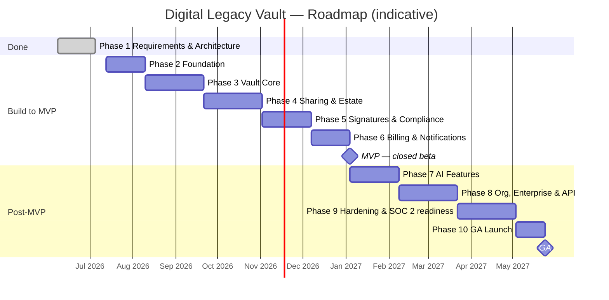

# Digital Legacy Vault — Development Roadmap

| Document control | |
|---|---|
| Version | 1.0.0 |
| Date | 2026-07-05 |
| Status | Draft for Review |
| Owner | Engineering Team |
| Related | `PROJECT_MEMORY.md` §4, §9; all `docs/06-engineering/*` |

Durations are indicative for a core team of 4–6 engineers + 1 designer, and assume phases 3–6 overlap partially (staggered starts) where dependencies allow. Every phase exits only when its quality gates (testing-strategy.md §11) are green and PROJECT_MEMORY §9 is updated.

---

## Phase 1 — Requirements & Architecture ✅ Complete 2026-07-05

- **Goals:** lock product scope, canonical decisions, architecture, security model, design system, engineering standards.
- **Key deliverables:** full `docs/` tree (requirements, architecture, security, design, engineering, planning), `PROJECT_MEMORY.md`, `PROJECT_STATE.md`.
- **Exit criteria:** docs internally consistent; canonical decisions signed off; Phase 2 approved. **Met.**
- **Dependencies:** none.
- **Duration:** complete.

## Phase 2 — Foundation (~4 weeks)

- **Goals:** a deployable walking skeleton with real auth, so every later phase ships onto working rails.
- **Key deliverables:** monorepo scaffold (pnpm + Turborepo, apps/api/web/workers, shared packages incl. `shared-kernel`, `crypto`, `design-tokens`, `ui`); Terraform baseline (3 AWS accounts + tooling, VPCs, EKS, RDS, Redis, ECR, Secrets Manager, KMS); Argo CD + Helm charts; full PR/main pipelines (cicd-pipeline.md); **identity context** end-to-end (register, login, JWT+refresh rotation, TOTP, passkeys, sessions, RBAC/CASL skeleton, org model); design-system foundations in `packages/ui` (tokens, buttons, inputs, shell).
- **Exit criteria:** `main` auto-deploys to dev; a user can register, enrol 2FA/passkey, and log in on staging; all CI gates active; DR skeleton (replication) provisioned.
- **Dependencies:** Phase 1 sign-off.
- **Duration:** 4 weeks.

## Phase 3 — Vault Core (~6 weeks)

- **Goals:** the product's heart — safe document storage.
- **Key deliverables:** upload pipeline (multipart → quarantine S3 → ClamAV → magic-byte validation → SHA-256 → promote, per security invariant §7.5); envelope encryption via `packages/crypto` (per-document DEK + KMS); `Document`/`DocumentVersion` versioning; categories/tags (document-type enum); OCR (Textract + Tesseract fallback) and metadata search (Postgres FTS first); document cards, dropzone, preview, timeline v1 (audit context + hash chain); Client-Encrypted Vault (client-side AES-256-GCM + Shamir recovery kit).
- **Exit criteria:** E2E journey 2 green; upload SLA budget met (p95 < 60 s ≤25 MB); audit chain verifiable; pen-test-style abuse suite for the pipeline passing.
- **Dependencies:** Phase 2 (identity, infra, crypto package).
- **Duration:** 6 weeks.

## Phase 4 — Sharing & Estate (~6 weeks)

- **Goals:** the "legacy" in Digital Legacy Vault — people and posthumous access.
- **Key deliverables:** sharing context (document shares, secure links, QR, access requests, expiry/revocation); estate context: `Beneficiary`, `Executor`, emergency access (multi-party quorum + time delay + owner notification per invariant §7.6), death-verification workflow v1 (manual document review by SUPPORT_AGENT + configurable verifiers); vault-relationship ABAC policies for EXECUTOR/BENEFICIARY/LAWYER/DOCTOR roles; empathetic bereavement UI flows per design-system §9.
- **Exit criteria:** E2E journeys 3–5 green; authz matrix suite covers all new role/resource pairs; legal review of emergency-access + death-verification flows complete.
- **Dependencies:** Phase 3 (documents to share), Phase 2 (roles).
- **Duration:** 6 weeks.

## Phase 5 — Signatures & Compliance (~5 weeks)

- **Goals:** ECTA-compliant signing and evidence preservation.
- **Key deliverables:** signature context (ceremony stepper, draw/type/upload pad, consent capture); cryptographic seal (SHA-256 digest, RFC 3161 trusted timestamp, signer identity + device evidence bundle — PROJECT_MEMORY §2.9); S3 Object Lock (compliance mode) for signed/legal docs; `LegalHold` entity + enforcement; consent management (`Consent`); POPIA/GDPR data-subject tooling v1 (export, deletion honouring holds); wills wet-ink guidance UX.
- **Exit criteria:** E2E journey 6 green; seal verification tool validates independently; external legal opinion on ECTA positioning documented; DSR export/delete round-trip tested.
- **Dependencies:** Phase 3 (documents), Phase 4 (parties to a signature).
- **Duration:** 5 weeks.

## Phase 6 — Billing & Notifications (~4 weeks) ← **MVP line at exit**

- **Goals:** monetisation + the communication fabric; everything needed for a paid closed beta.
- **Key deliverables:** billing context (Plans, Subscriptions, Stripe checkout + billing portal, ZAR primary + USD/EUR, webhooks, entitlement enforcement of freemium limits); notification context (SES email, Twilio SMS/WhatsApp, web push, per-category preferences, reminders); PWA completion (offline shell, install, push); admin back-office v1 (support tooling, audit search).
- **Exit criteria:** E2E journeys 7 green; dunning + proration verified in Stripe test clocks; notification opt-in/out honoured incl. non-disableable emergency alerts; **MVP checklist signed → closed beta begins**.
- **Dependencies:** Phases 2–5 (entitlements gate their features).
- **Duration:** 4 weeks.

---

**═══════════ MVP (end of Phase 6): closed beta, paying customers ═══════════**

---

## Phase 7 — AI Features (~5 weeks)

- **Goals:** differentiated assistance without compromising the trust model.
- **Key deliverables:** `AiGateway` abstraction over Anthropic Claude API (PROJECT_MEMORY §2.8); document classification + auto-categorisation; summaries; completeness recommendations ("you have a will but no medical directive"); natural-language search; strict exclusion of Client-Encrypted Vault content (type-enforced per coding-standards §10.8); AI usage disclosure UX + per-user opt-out.
- **Exit criteria:** classification precision ≥90% on the synthetic corpus; zero client-encrypted objects in AI telemetry (audited); cost-per-request budgets instrumented.
- **Dependencies:** Phase 3 (OCR/text), Phase 6 (plan gating for AI features).
- **Duration:** 5 weeks.

## Phase 8 — Organisations, Enterprise & Integrations API (~6 weeks)

- **Goals:** B2B plans for law firms, medical practices, financial advisers.
- **Key deliverables:** organisation workspaces (members, COMPANY_ADMIN/HOSPITAL_ADMIN roles, client-vault relationships for LAWYER/DOCTOR/FINANCIAL_ADVISER); enterprise SSO (OAuth2 now, SAML per PROJECT_MEMORY §3); integration context: API keys, scoped partner API (`/api/v1`), webhooks with signed deliveries + retries; usage metering for org billing; data-residency controls surfaced for org admins.
- **Exit criteria:** org onboarding E2E green; partner API contract published (OpenAPI 3.1) with versioning policy; webhook delivery ≥99.9% within 5 min in soak test.
- **Dependencies:** Phase 6 (billing), Phase 2 (org model foundation).
- **Duration:** 6 weeks.

## Phase 9 — Hardening, Pentest & SOC 2 Readiness (~6 weeks)

- **Goals:** production-grade assurance before GA (SOC 2 Type II is a target, not a launch blocker — PROJECT_MEMORY §2.1).
- **Key deliverables:** external penetration test + full remediation; chaos/DR programme results incl. full-region failover drill meeting RPO 15 min/RTO 4 h; performance load tests at 5× projected launch traffic; SOC 2 readiness: control mapping, evidence automation, policy set; ISO 27001 alignment review; POPIA operator/GDPR processor documentation; on-call rotation, SLOs + error budgets, incident management runbooks finalised; accessibility full audit (WCAG 2.2 AA) with remediation.
- **Exit criteria:** zero open critical/high pentest findings; DR drill within targets; SOC 2 observation window started; accessibility audit passed; go/no-go review passed.
- **Dependencies:** Phases 2–8 feature-complete (scope freeze at Phase 9 start).
- **Duration:** 6 weeks.

## Phase 10 — GA Launch (~3 weeks)

- **Goals:** public availability in South Africa; EU-ready posture.
- **Key deliverables:** production scale-up + cost guardrails; marketing site + onboarding polish; support processes (SUPPORT_AGENT tooling, SLAs, help centre); beta-feedback punch list; launch comms; post-launch monitoring war-room week; pricing/plan final configuration.
- **Exit criteria:** GA checklist signed by engineering, design, security, legal; 2 weeks post-launch with SLOs met and error budget ≥50% remaining; PROJECT_MEMORY §9 updated to "Live".
- **Dependencies:** Phase 9 go decision.
- **Duration:** 3 weeks (+2 weeks stabilisation watch).

---

## Timeline (Mermaid Gantt)

Dates assume sequential starts with Phase 2 beginning 2026-07-13 (first Monday after approval); real starts may overlap by up to 30% where dependencies permit.

Indicative calendar: MVP ≈ 2026-12-04 (allowing a mid-December freeze, closed beta runs through January); GA ≈ 2027-05-14. Dates are planning aids, not commitments; the release train (deployment-strategy.md §9) governs actual shipping.

## Cross-phase workstreams (continuous)

- **Security:** every phase, not a phase — invariants (PROJECT_MEMORY §7) enforced from Phase 2 CI onward.
- **Accessibility & design QA:** per-release manual passes from Phase 3.
- **Documentation:** ADRs + PROJECT_MEMORY updates in the same PR as the decision.
- **Compliance evidence:** collected automatically from Phase 2 (audit events, pipeline attestations) so Phase 9 assembles rather than excavates.
